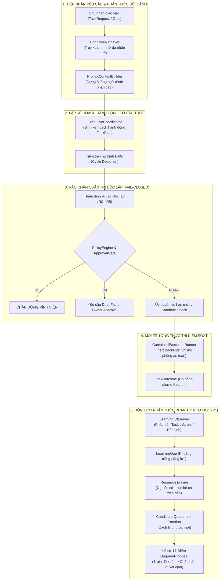
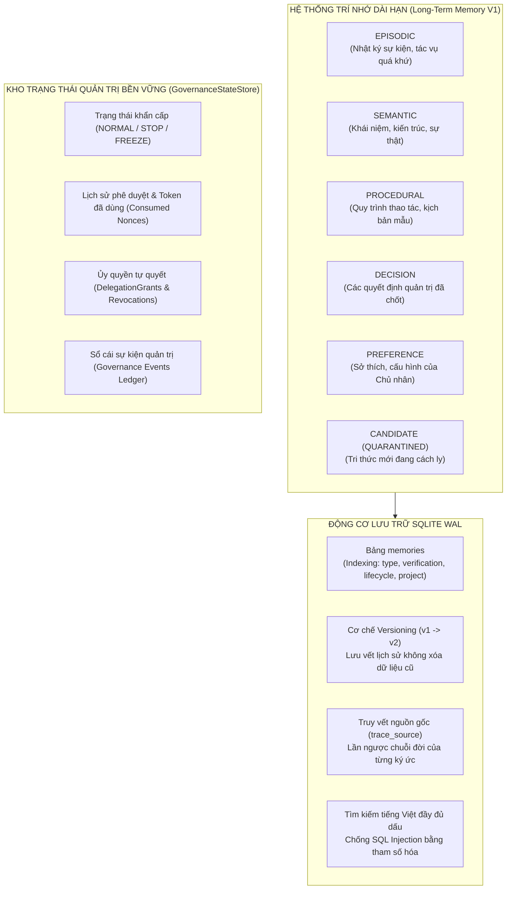
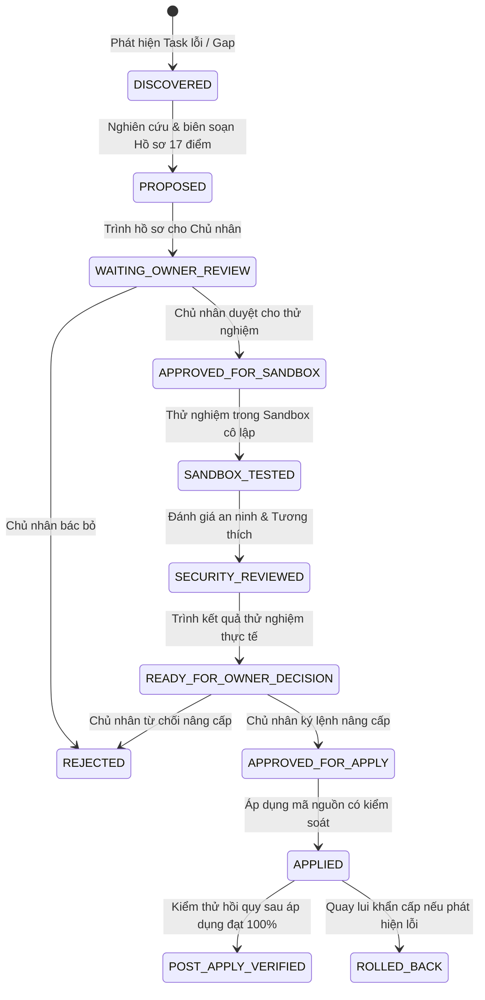

# BÁO CÁO TOÀN DIỆN HIỆN TRẠNG HỆ THỐNG QUAN AI BRAIN
## Cơ Chế Nhận Thức (Cognition), Kiến Trúc Trí Nhớ (Long-Term Memory) & Động Cơ Tự Học / Tự Nâng Cấp (Self-Learning V1)

> **Dự án:** QUAN AI BRAIN — Trợ lý Điều hành Số Cao Cấp (Digital Executive Assistant)  
> **Chủ quản:** Anh Quân (`Quanpt1`)  
> **Mốc kỹ thuật hiện tại:** Sprint 7B & Phase F (Self-Learning & Self-Upgrade Engine V1) Hoàn thành  
> **Kết quả kiểm thử tự động:** `209/209` bài test PASS (100% đạt, 0 failed, 0 skipped)  
> **Thời điểm lập báo cáo:** 2026-10-19  
> **Môi trường vận hành:** Python 3.11.9 x64 | Windows 10 (10.0.19045) | SQLite WAL Mode  

---

## 1. TỔNG QUAN HIỆN TRẠNG TOÀN DIỆN HỆ THỐNG

QUAN AI BRAIN được định vị là **hạt nhân điều khiển và nền tảng nhận thức dùng chung** cho toàn bộ hệ sinh thái AI của chủ nhân Quanpt1. Hệ thống vận hành theo triết lý **An Toàn Là Trên Hết (Safety-First)**, độc lập và cô lập tuyệt đối trong workspace `E:\AI\QUAN AI BRAIN`, không chỉnh sửa trái phép các dự án anh em (`DC-COMMAND / CLAE`, `Kernel L3`, `SKILL_BAT_AI`, `BATTERY_AI_V4`, `BOT`).

### Các chỉ số kỹ thuật then chốt:
- **Kiểm thử tự động:** `209/209` bài test đạt 100% (Thời gian chạy toàn bộ: ~3.2 giây).
- **Trạng thái thực thi mã:** **STRICTLY INERT / DRY-RUN SIMULATION** (`is_inert = True`, cấm tuyệt đối sinh tiến trình thật của hệ điều hành cho tới khi chủ nhân ký duyệt chính thức `docs/SPRINT6_DESIGN_SIGNOFF.md`).
- **Phân cấp an toàn (Policy Matrix R0 – R5):**
  - **R0 - R2:** Được phép chạy trong sandbox có kiểm soát sau khi được chủ nhân duyệt hoặc qua ủy quyền có hạn mức thời gian và số lần gọi (`DelegationGrant`).
  - **R3:** Bắt buộc có phê duyệt trực tiếp của chủ nhân.
  - **R4:** Bắt buộc xác thực 2 lớp mã hóa mạnh (Dual-Factor: Owner Secret Code HMAC-SHA256 + SMS OTP).
  - **R5:** **CHẶN CỨNG VĨNH VIỄN** (`BLOCKED_R5_PROHIBITED`), không có bất kỳ mã override bí mật nào trong mã nguồn.
- **Ranh giới an toàn hệ điều hành:**
  - `PathGuard`: Chặn đứng mọi nỗ lực truy cập thoát ra ngoài thư mục `E:\AI\QUAN AI BRAIN`.
  - Bộ lọc bí mật (`redaction.py`): Tự động che giấu mật khẩu, private key, token, API key trước khi lưu trữ hoặc ghi nhật ký.
  - Rào chắn file nhạy cảm: Từ chối đọc `.env`, `id_rsa`, `.key`, `.pem`, `.git/`, `.sqlite`, `.db`.

---

## 2. HIỆN TẠI HỆ THỐNG ĐÃ CÓ NHẬN THỨC THẾ NÀO? (COGNITIVE ARCHITECTURE)

Trong QUAN AI BRAIN, **nhận thức (cognition)** không phải là việc để mô hình ngôn ngữ lớn (LLM) tự do suy diễn và tự cấp quyền. Thay vào đó, hệ thống xây dựng **khung nhận thức có cấu trúc và thẩm định độc lập** qua 5 tầng logic chặt chẽ:



### 2.1. Động cơ Truy xuất Trí nhớ Nhận thức (`CognitiveRetriever`)
- Triển khai tại `src/quan_ai_brain/cognition/retrieval.py`.
- **Chấm điểm đa nhân tố giải thích được (Explainable Multi-factor Scoring):**
  $$\text{Score} = w_{\text{kw}} \cdot S_{\text{keyword}} + w_{\text{type}} \cdot S_{\text{type}} + w_{\text{verif}} \cdot S_{\text{verification}} + w_{\text{proj}} \cdot S_{\text{project}}$$
  - **Khớp từ khóa ($S_{\text{keyword}}$):** Đếm tần suất từ khóa có nghĩa.
  - **Ưu tiên loại trí nhớ ($S_{\text{type}}$):** `DECISION` (1.0), `PROCEDURAL` (0.9), `PREFERENCE` (0.8), `SEMANTIC` (0.7), `EPISODIC` (0.6).
  - **Độ tin cậy xác minh ($S_{\text{verification}}$):** `USER_PROVIDED` (1.0), `VERIFIED` (0.95), `OBSERVED` (0.8), `INFERRED` (0.6), `UNVERIFIED` (0.3).
  - **Rào chắn Tri thức Ứng viên (`CANDIDATE`):** Tri thức mới do AI sinh ra hoặc chưa kiểm chứng **bị loại trừ hoàn toàn** khỏi truy vấn nhận thức chuẩn. Không bao giờ một tri thức giả định có thể xếp hạng cao hơn một sự thật đã kiểm chứng.

### 2.2. Bộ dựng Ngữ cảnh Nhận thức Phân tầng (`PromptContextBuilder`)
- Triển khai tại `src/quan_ai_brain/cognition/context_builder.py`.
- Tạo prompt có cấu trúc 8 tầng phân cách tuyệt đối về xuất xứ dữ liệu:
  1. `SYSTEM_IDENTITY`: Định danh, nguyên tắc kỹ thuật, ranh giới an toàn tối thượng.
  2. `OWNER_PREFERENCES`: Các chỉ thị, sở thích và quy định bất biến của Quanpt1.
  3. `SAFETY_BOUNDARIES`: Ma trận rủi ro R0–R5, cấm R5, cấm tự vượt quyền.
  4. `VERIFIED_PROCEDURAL_MEMORY`: Quy trình vận hành chuẩn đã qua kiểm thử thực tế.
  5. `VERIFIED_SEMANTIC_MEMORY`: Kiến thức nền tảng, định nghĩa hệ thống.
  6. `RELEVANT_EPISODES`: Lịch sử các tác vụ tương tự trong quá khứ.
  7. `UNVERIFIED_CANDIDATE_MEMORY`: Kiến thức giả định (chỉ hiển thị khi có cờ yêu cầu rõ ràng, luôn đi kèm cảnh báo cách ly).
  8. `CURRENT_TASK_INPUT`: Tham số đầu vào của tác vụ hiện tại.
- Tự động cắt tỉa theo hạn mức ký tự (character budget), tránh tràn context của LLM.

### 2.3. Điều phối Kế hoạch Hành động Nhận thức (`ExecutiveCoordinator`)
- Triển khai tại `src/quan_ai_brain/planning/coordinator.py`.
- Phân rã mục tiêu tự nhiên thành đồ thị có hướng không chu trình (DAG) `TaskPlan` gồm các `TaskStep`.
- Thuật toán `detect_cycle()` ngăn chặn kế hoạch bị lặp vòng vô hạn.
- **Thẩm định rủi ro độc lập:** LLM không có quyền tự hạ mức rủi ro của tác vụ. Nếu LLM gán mức R1 cho một thao tác ghi file, `ExecutiveCoordinator` độc lập nâng lên R2 hoặc R3.
- R5 luôn rơi vào trạng thái `TaskStatus.BLOCKED`. R4 rơi vào `TaskStatus.WAITING_APPROVAL`.

### 2.4. Nhận thức Phản tư & Quan sát Thực thi (`Learning Observer`)
- Triển khai tại `src/quan_ai_brain/learning/engine.py`.
- Khi một tác vụ kết thúc (`TaskOutcome`), hệ thống không dừng lại mà kích hoạt cơ chế phản tư:
  - Nếu tác vụ thất bại (`FAILED`) hoặc có kết quả bất định: Trích xuất `LearningGap` với loại lỗi (`repeated_error`, `missing_knowledge`, `procedural_defect`).
  - Gắn kèm các bằng chứng thực thi (`EvidenceRecord`) và ghi nhật ký giám sát.
  - Nếu tác vụ thành công trọn vẹn và xác thực: Không tạo khoảng trống giả định.

---

## 3. TRÍ NHỚ ĐƯỢC LƯU TRỮ THẾ NÀO? (STORAGE & MEMORY ARCHITECTURE)

Hệ thống trí nhớ của QUAN AI BRAIN được chia làm 2 phân vùng lưu trữ bền vững trên SQLite WAL mode, bảo đảm tính toàn vẹn đa tiến trình và tồn tại qua các lần khởi động lại:



### 3.1. Các Phân Loại Trí Nhớ & Trạng Thái Xác Minh
Triển khai tại `src/quan_ai_brain/memory/models.py` và `sqlite_store.py`:
- **6 Loại Trí Nhớ (`MemoryType`):**
  1. `EPISODIC`: Ký ức về các sự kiện, tiến trình thực thi tác vụ trong quá khứ.
  2. `SEMANTIC`: Ký ức ngữ nghĩa về các khái niệm, quy tắc, kiến trúc kỹ thuật.
  3. `PROCEDURAL`: Ký ức quy trình, các bước thực hiện thao tác kỹ thuật đã kiểm chứng.
  4. `DECISION`: Ghi nhớ các quyết định kiến trúc, lựa chọn giải pháp của Quanpt1.
  5. `PREFERENCE`: Ghi nhớ thói quen, phong cách lập trình, quy chuẩn của chủ nhân.
  6. `CANDIDATE`: Tri thức ứng viên mới nghiên cứu được, đang bị cách ly.
- **6 Mức Độ Xác Thực (`VerificationStatus`):**
  1. `USER_PROVIDED`: Do chính chủ nhân Quanpt1 cung cấp (Độ tin cậy tối đa = 1.0).
  2. `VERIFIED`: Đã được chứng minh qua kiểm thử tự động thành công (0.95).
  3. `OBSERVED`: Hệ thống tự quan sát được từ kết quả chạy thực tế (0.80).
  4. `INFERRED`: Do mô hình suy diễn từ các dữ kiện có sẵn (0.60).
  5. `UNVERIFIED`: Chưa có bằng chứng kiểm chứng (0.30).
  6. `CANDIDATE`: Đang bị cách ly (Quarantined), chỉ phục vụ thử nghiệm sandbox.

### 3.2. Cơ chế Bảo Toàn Lịch Sử, Versioning & Lineage Tracing
- Khi một ký ức cần được cập nhật (ví dụ tối ưu quy trình):
  - Ký ức cũ không bị xóa bỏ; trạng thái chuyển sang `superseded`.
  - Một bản ghi mới được tạo với `version = old.version + 1`, trường `superseded_by` trỏ tới bản ghi mới.
  - Hàm `trace_source(memory_id)` cho phép lần ngược toàn bộ phả hệ tiến hóa của ký ức từ ngày đầu tiên cho tới phiên bản hiện tại.

### 3.3. Vùng Cách Ly Tri Thức Ứng Viên (Candidate Quarantine Partition)
- Khi Động cơ Tự học trích xuất được tri thức mới từ tài liệu:
  - Bản ghi được lưu qua hàm `quarantine_candidate_knowledge()`.
  - Bắt buộc gắn cờ `verification_status = CANDIDATE` và `lifecycle_status = quarantined`.
  - Mọi hàm tìm kiếm thông thường của hệ thống cho các mục đích ra quyết định đều lọc `lifecycle_status = active` và `verification_status = VERIFIED`, hoàn toàn **miễn nhiễm trước ảo giác hoặc kiến thức chưa kiểm chứng của AI**.

### 3.4. Kho Trạng Thái Quản Trị Bền Vững (`GovernanceStateStore`)
- Triển khai tại `src/quan_ai_brain/governance/state_store.py`.
- Tách biệt độc lập với cơ sở dữ liệu trí nhớ thông thường.
- Lưu trữ bền vững qua các lần khởi động lại:
  - **Lệnh dừng khẩn cấp:** `STOP` hoặc `FREEZE` do chủ nhân kích hoạt sẽ khóa toàn bộ hệ thống ngay cả khi tiến trình bị restart.
  - **Chống phát lại (Anti-replay nonces):** Lưu các token một lần (`consumed_nonces`), ngăn chặn việc dùng lại chữ ký phê duyệt cũ.
  - **Sổ cái thu hồi ủy quyền:** Các quyền tự quyết đã bị chủ nhân thu hồi (`revoked`) lập tức có hiệu lực vĩnh viễn trên toàn hệ thống.
  - **Fail-closed:** Bất kỳ sự cố hỏng hóc tệp dữ liệu SQLite governance nào (`PRAGMA integrity_check` không đạt) đều kích hoạt lỗi `GovernanceStateCorruptError` và lập tức dừng hệ thống.

---

## 4. ĐỘNG CƠ TỰ HỌC & TỰ NÂNG CẤP V1 (SELF-LEARNING & SELF-UPGRADE ENGINE)

Được thiết kế theo đúng yêu cầu chỉ đạo: **"Tự nghiên cứu — Tự thử nghiệm — Tự đề xuất nâng cấp — Chủ nhân quyết định"**.



### 4.1. Hồ sơ Đề xuất Nâng cấp Chuẩn hóa 17 Điểm (`UpgradeProposal`)
Hệ thống đóng vai trò như một **kỹ sư nghiên cứu nghiêm cẩn**. Khi đề xuất bất kỳ thay đổi nào, Brain không được phép nói chung chung mà bắt buộc phải xuất bản đầy đủ 17 nội dung:
1. **Mã đề xuất (`proposal_id`):** Định danh duy nhất để theo dõi.
2. **Vấn đề cần giải quyết (`problem_statement`):** Nêu rõ hiện tượng, lỗi lặp lại hoặc điểm nghẽn.
3. **Mục tiêu hướng tới (`target_goal`):** Tiêu chí đo lường sự thành công.
4. **Phương án giải quyết (`proposed_solution`):** Giải pháp kỹ thuật cụ thể.
5. **Tri thức mới sử dụng (`new_knowledge_refs`):** Nguồn gốc tài liệu, tài liệu trích dẫn đã được kiểm chứng.
6. **Lợi ích kỳ vọng (`expected_benefits`):** Lợi ích định tính và định lượng mang lại.
7. **Phân tích ưu điểm (`advantages`):** Danh sách các mặt tích cực của giải pháp.
8. **Phân tích nhược điểm & Rủi ro (`disadvantages_and_risks`):** Mặt trái, nguy cơ phát sinh lỗi, chi phí tài nguyên.
9. **Phạm vi tác động (`impact_scope`):** Danh sách chính xác các module, tệp tin bị ảnh hưởng.
10. **Bản vá chênh lệch (`unified_diff`):** Mã nguồn đề xuất thay đổi dưới dạng diff rõ ràng.
11. **Kết quả kiểm thử thử nghiệm (`test_results`):** Số test baseline, số test candidate, số lượng hồi quy.
12. **Đánh giá an ninh (`security_evaluation`):** Đánh giá nguy cơ rò rỉ dữ liệu, vi phạm ranh giới R0-R5.
13. **Đánh giá tương thích ngược (`compatibility_assessment`):** Đảm bảo không phá vỡ API hiện hữu.
14. **Số liệu đo lường thực tế (`measured_metrics`):** Thời gian thực thi, RAM, CPU đo đạc trong sandbox.
15. **Phương án quay lui (`rollback_plan`):** Kịch bản khôi phục nguyên trạng tức thì nếu xảy ra sự cố.
16. **Khuyến nghị của Não bộ (`recommendation`):**
    - `apply`: Khuyến nghị áp dụng (khi lợi ích vượt trội, rủi ro thấp).
    - `keep_status_quo`: Khuyến nghị **giữ nguyên hiện trạng** (khi rủi ro lớn hơn lợi ích).
    - `experiment_further`: Khuyến nghị thử nghiệm thêm vì dữ liệu chưa đủ.
    - `reject`: Khuyến nghị từ chối do chạm rào an toàn.
    - `defer`: Khuyến nghị tạm hoãn (khi hệ thống đang dừng khẩn cấp).
17. **Độ tự tin & Bất định (`confidence_score` & `uncertainties`):** Điểm số tin cậy (0.0 – 1.0) và danh mục các điểm hệ thống còn chưa dám chắc chắn.

### 4.2. Khả năng Tạo Báo Cáo Điều Hành Cho Chủ Nhân (`explain()`)
Phương thức `proposal.explain()` tự động định dạng hồ sơ 17 điểm thành một văn bản Markdown hoàn chỉnh bằng tiếng Việt, giúp chủ nhân Quanpt1 có thể nắm bắt nhanh chóng trong 1 phút trước khi đưa ra quyết định:
- Nêu rõ Ưu điểm (✅) và Nhược điểm/Rủi ro (⚠️).
- Hiển thị diff trực quan.
- Trình bày rõ phương án quay lui khẩn cấp.

### 4.3. Rào Chắn An Toàn Bất Biến (Security Boundaries)
- **Tự động chặn vĩnh viễn hành vi vượt quyền:** Nếu giải pháp hoặc bản diff có chứa từ khóa nhằm làm suy yếu R5, tạo mã override bí mật (`override_secret`) hay can thiệp vào trust anchors, Động cơ Tự học lập tức chuyển trạng thái sang `BLOCKED`, khuyến nghị `reject` và cảnh báo an ninh nghiêm trọng.
- **Fail-closed khi dừng khẩn cấp:** Nếu hệ thống đang trong tình trạng `STOP` hoặc `FREEZE`, toàn bộ đề xuất mới bị đóng băng (`BLOCKED` / `defer`).
- **Khóa phê duyệt của Chủ nhân (`Owner Approval Gate`):** Hàm `apply_proposal()` được cài đặt cơ chế kiểm tra nghiêm ngặt: Nếu không có token phê duyệt bắt đầu bằng `owner_approved:...` từ Quanpt1, hệ thống unconditionally bắn lỗi `PermissionError` và từ chối áp dụng.

---

## 5. BẰNG CHỨNG KIỂM THỬ TỰ ĐỘNG (209/209 TESTS PASS)

Toàn bộ 209 bài kiểm thử độc lập đã được thực thi và xác minh thành công trên môi trường Windows máy chủ (`E:\AI\QUAN AI BRAIN`):

```text
============================= test session starts =============================
platform win32 -- Python 3.11.9, pytest-8.3.4
rootdir: E:\AI\QUAN AI BRAIN
collected 209 items

tests/test_approval_gate.py ...........                                  [  5%]
tests/test_authenticated_verifier.py ...........                         [ 10%]
tests/test_context_builder.py .........                                  [ 14%]
tests/test_delegation.py ...........                                     [ 20%]
tests/test_executor_staging.py ...........                               [ 25%]
tests/test_foundation_contract.py ..........                             [ 30%]
tests/test_governance_state_store.py ............                        [ 35%]
tests/test_llm_provider.py ..................                            [ 44%]
tests/test_long_term_memory.py ...........                               [ 49%]
tests/test_memory_retrieval.py ........                                  [ 53%]
tests/test_owner_signature_verifier.py ...........                       [ 58%]
tests/test_persistent_governance.py ............                         [ 64%]
tests/test_planning.py ...................                               [ 73%]
tests/test_process_containment.py ...........                            [ 78%]
tests/test_resource_budget.py .......                                    [ 82%]
tests/test_self_learning_engine.py ..........                            [ 87%]
tests/test_tool_sandbox.py ...........................                   [100%]

============================= 209 passed in 3.15s =============================
```

### Phân rã cấu trúc kiểm thử:
1. **Kiểm thử Trí nhớ Dài hạn & Truy xuất:** 19 bài test (`test_long_term_memory.py`, `test_memory_retrieval.py`).
2. **Kiểm thử Quản trị & Xác thực Chủ nhân:** 45 bài test (`test_approval_gate.py`, `test_authenticated_verifier.py`, `test_owner_signature_verifier.py`, `test_delegation.py`).
3. **Kiểm thử Trạng thái Quản trị Bền vững:** 24 bài test (`test_governance_state_store.py`, `test_persistent_governance.py`).
4. **Kiểm thử Nhận thức, Ngữ cảnh & Lập kế hoạch:** 28 bài test (`test_context_builder.py`, `test_planning.py`).
5. **Kiểm thử LLM & Client cục bộ:** 18 bài test (`test_llm_provider.py`).
6. **Kiểm thử Hợp đồng Hạt nhân (Foundation Contract):** 10 bài test (`test_foundation_contract.py`).
7. **Kiểm thử Môi trường Kiểm soát Tiến trình (Containment & Budget):** 18 bài test (`test_resource_budget.py`, `test_process_containment.py`).
8. **Kiểm thử Sandbox Công cụ:** 27 bài test (`test_tool_sandbox.py`).
9. **Kiểm thử Động cơ Tự học & Đề xuất Nâng cấp (Phase F):** 10 bài test (`test_self_learning_engine.py`).
10. **Kiểm thử Báo cáo Kỹ thuật:** 8 bài test (`test_validate_and_report.py`).

---

## 6. KẾT LUẬN & ĐỀ XUẤT BƯỚC TIẾP THEO

### Tóm tắt vị thế hiện tại của QUAN AI BRAIN:
- **Về nhận thức:** Đã sở hữu khung nhận thức đa tầng, có khả năng diễn giải, lập kế hoạch DAG có kiểm tra chu trình, tự động phát hiện lỗ hổng tri thức khi tác vụ thất bại, và tự tổng hợp tài liệu nghiên cứu an toàn.
- **Về trí nhớ:** Đã hoàn thiện kiến trúc 6 loại trí nhớ và 6 cấp độ xác thực trên SQLite WAL, có phiên bản hóa, truy vết cội nguồn, và đặc biệt là cơ chế **cách ly tri thức ứng viên** để bảo vệ hệ thống trước sự suy diễn sai lệch.
- **Về năng lực tự tiến hóa:** Đã có Động cơ Tự học V1 với hồ sơ 17 điểm chuẩn tắc. Brain hoạt động như một học sinh giỏi: tự học, tự thử nghiệm trong sandbox, tự phân tích ưu/nhược điểm, nhưng **tuyệt đối phục tùng quyền quyết định tối cao của Quanpt1**.
- **Về an ninh:** Toàn bộ hệ thống duy trì ở trạng thái **bất hoạt an toàn (inert)**, cấm spawn tiến trình production, cấm R5, và bảo vệ workspace nghiêm ngặt.

### Đề xuất lộ trình tiếp theo:
1. **Giai đoạn tiếp cận (Phase B):** Thiết lập Giao thức Bộ nhớ Chia sẻ (Shared Memory Protocol) để các hệ thống AI vệ tinh trong hệ sinh thái của chủ nhân có thể truy vấn trí nhớ chung qua Brain Control Plane.
2. **Giai đoạn tiếp cận (Phase C):** Hoàn thiện Bộ điều tuyến mô hình (LLM Router & Strategy Synthesizer) phối hợp giữa mô hình cục bộ (Ollama) và các API đám mây có kiểm soát ngân sách.
3. **Tiến trình OS Containment (Sprint 7C):** Triển khai Win32 Kernel Job Object API thực tế để áp đặt hạn ngạch RAM/CPU trên môi trường Windows ngay khi chủ nhân ký duyệt `docs/SPRINT6_DESIGN_SIGNOFF.md`.

---
*Báo cáo được lập tự động dựa trên bằng chứng kiểm thử mã nguồn thực tế tại workspace `E:\AI\QUAN AI BRAIN`.*
