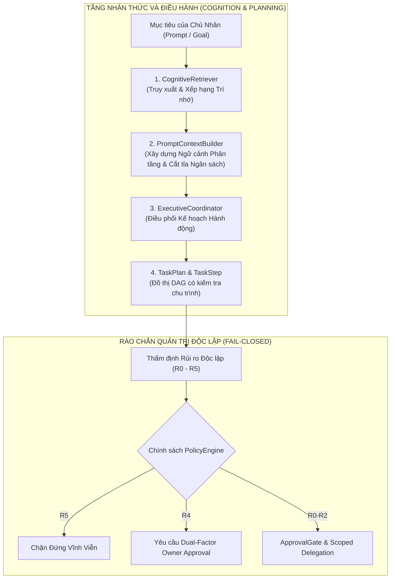
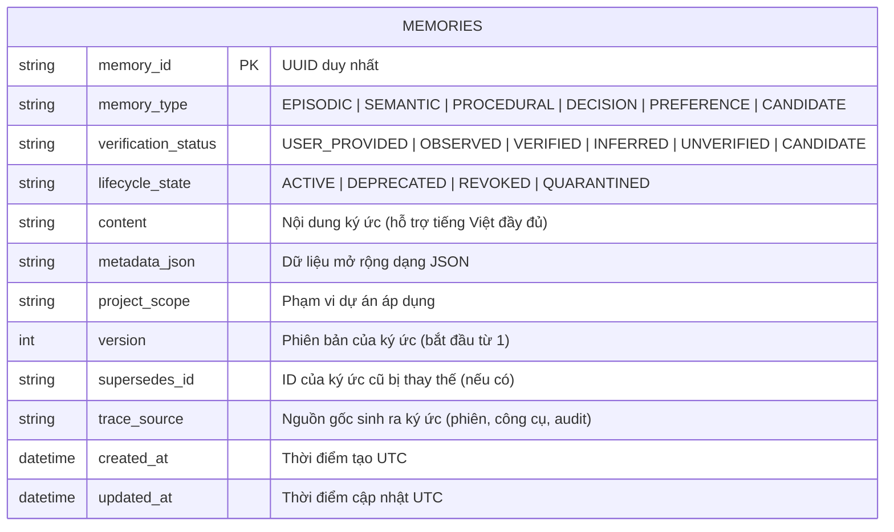

# BÁO CÁO TOÀN DIỆN HIỆN TRẠNG HỆ THỐNG QUAN AI BRAIN (SPRINT 7B)
## Cơ Chế Nhận Thức (Cognition) & Kiến Trúc Lưu Trữ Trí Nhớ (Long-Term Memory)

> **Dự án:** QUAN AI BRAIN — Trợ lý Điều hành Số Cao Cấp (Digital Executive Assistant)  
> **Chủ quản:** Anh Quân (Quanpt1)  
> **Mốc phát triển:** Sprint 7B Hoàn thành (189/189 bài test tự động PASS)  
> **Thời điểm lập báo cáo:** 2026-10-18  
> **Môi trường:** Python 3.11.9 x64 | Windows 10 (10.0.19045) | SQLite WAL  

---

## 1. TỔNG QUAN HIỆN TRẠNG TOÀN HỆ THỐNG ĐẾN SPRINT 7B

Hệ thống **QUAN AI BRAIN** được xây dựng theo triết lý **An Toàn Là Trên Hết (Safety-First)**, hoạt động theo mô hình *Cognitive Micro-Kernel* khép kín trong workspace `E:\AI\QUAN AI BRAIN`, độc lập và tuyệt đối không can thiệp trái phép vào các dự án anh em (`DC-COMMAND / CLAE`, `Kernel L3`, `SKILL_BAT_AI`, `BATTERY_AI_V4`, `BOT`).

### Chỉ số kỹ thuật chính:
- **Tổng số bài kiểm thử tự động:** `189/189` bài test đạt 100% (Pass rate: 100%, 0 failed, 0 skipped).
- **Trạng thái thực thi:** **STRICTLY INERT / DRY-RUN SIMULATION** (Chưa spawn bất kỳ tiến trình OS thật nào; `is_inert = True`, cấm thực thi production khi `docs/SPRINT6_DESIGN_SIGNOFF.md` đang ở trạng thái `PENDING_OWNER_SIGNOFF`).
- **Phân cấp an toàn:** Ma trận rủi ro R0 – R5:
  - **R0 - R2:** Được phép chạy trong sandbox có kiểm soát sau khi chủ nhân duyệt hoặc qua ủy quyền có hạn mức (`DelegationGrant`).
  - **R3:** Bắt buộc có sự chấp thuận trực tiếp của chủ nhân.
  - **R4:** Bắt buộc xác thực 2 lớp (Dual-Factor: Owner Secret Code HMAC-SHA256 + SMS OTP).
  - **R5:** **CHẶN CỨNG VĨNH VIỄN** (`BLOCKED_R5_PROHIBITED`), không có bất kỳ mã override nào trong mã nguồn.

---

## 2. HIỆN TẠI HỆ THỐNG ĐÃ CÓ NHẬN THỨC THẾ NÀO? (COGNITIVE ARCHITECTURE)

Nhận thức trong **QUAN AI BRAIN** không phải là việc để mô hình ngôn ngữ lớn (LLM) tự do suy diễn và tự cấp quyền. Thay vào đó, hệ thống trang bị một **khung nhận thức có cấu trúc (Structured Cognition)** gồm 4 trụ cột toán học và kỹ thuật phần mềm xác định:

### 2.1. Động cơ Truy xuất Trí nhớ Nhận thức (`CognitiveRetriever`)
Được triển khai tại `src/quan_ai_brain/cognition/retrieval.py`:
- **Truy xuất đa nhân tố giải thích được (Explainable Multi-factor Scoring):** Điểm xếp hạng nhận thức của một ký ức đối với một truy vấn được tính toán theo công thức:
  $$\text{Score} = w_{\text{kw}} \cdot S_{\text{keyword}} + w_{\text{type}} \cdot S_{\text{type}} + w_{\text{verif}} \cdot S_{\text{verification}} + w_{\text{proj}} \cdot S_{\text{project}}$$
  - **Độ trùng khớp từ khóa ($S_{\text{keyword}}$):** Đếm tần suất xuất hiện của các từ khóa có ý nghĩa trong nội dung ký ức.
  - **Trọng số loại trí nhớ ($S_{\text{type}}$):** Ưu tiên trí nhớ `DECISION` (1.0), `PROCEDURAL` (0.9), `PREFERENCE` (0.8), `SEMANTIC` (0.7), `EPISODIC` (0.6).
  - **Độ tin cậy xác thực ($S_{\text{verification}}$):** `USER_PROVIDED` (1.0), `VERIFIED` (0.95), `OBSERVED` (0.8), `INFERRED` (0.6), `UNVERIFIED` (0.3).
  - **Phù hợp phạm vi dự án ($S_{\text{proj}}$):** Khớp chính xác tên dự án (1.0) hoặc phạm vi toàn cục (0.7).
- **Rào chắn Cách ly Tri thức Ứng viên (Candidate Knowledge Quarantine):**
  - Mọi ký ức ở trạng thái `CANDIDATE` (do AI tự sinh hoặc chưa qua kiểm chứng) **bị loại trừ hoàn toàn** khỏi truy vấn nhận thức mặc định.
  - Ngay cả khi được yêu cầu rõ ràng, tri thức ứng viên cũng bị áp trần điểm tin cậy cực thấp, **tuyệt đối không bao giờ có thể xếp hạng cao hơn một sự thật đã được xác minh**.

### 2.2. Bộ dựng Ngữ cảnh Nhận thức (`PromptContextBuilder`)
Được triển khai tại `src/quan_ai_brain/cognition/context_builder.py`:
- **Phân tách xuất xứ nghiêm ngặt (Strict Provenance Separation):** Ngữ cảnh nạp cho LLM được chia thành 8 phân tầng độc lập, có ranh giới rõ ràng để chống tấn công *Prompt Injection* từ nội dung ký ức:
  1. `SYSTEM_IDENTITY`: Quy tắc hành xử cốt lõi, giới hạn quyền lực.
  2. `OWNER_PREFERENCES`: Các chỉ thị, thói quen và quy định cố định của chủ nhân.
  3. `VERIFIED_SEMANTIC_FACTS`: Tri thức kỹ thuật và sự thật đã được kiểm chứng.
  4. `PROCEDURAL_GUIDELINES`: Các quy trình vận hành tiêu chuẩn (SOP).
  5. `PAST_DECISIONS`: Các quyết định kiến trúc đã được chốt từ trước.
  6. `RECENT_EPISODES`: Lịch sử các phiên làm việc gần nhất.
  7. `CURRENT_TASK_CONSTRAINTS`: Ràng buộc cụ thể của tác vụ hiện hành.
  8. `QUARANTINED_CANDIDATES`: Các ứng viên tri thức (nếu được yêu cầu kiểm toán).
- **Kiểm soát Ngân sách Ký tự (Character Budgeting):** Tự động cắt tỉa các ký ức điểm thấp khi vượt quá hạn mức độ dài (ví dụ: tối đa 8.000 ký tự), ngăn chặn tràn bộ nhớ ngữ cảnh và giảm độ trễ phản hồi.

### 2.3. Điều phối Kế hoạch Điều hành (`ExecutiveCoordinator`)
Được triển khai tại `src/quan_ai_brain/planning/coordinator.py`:
- **Phân rã Mục tiêu thành Đồ thị Hướng có Hướng không Chu trình (DAG):**
  - Chuyển hóa mục tiêu tự nhiên của người dùng thành `TaskPlan` gồm các bước `TaskStep` có ID duy nhất (`step_id`).
  - Tự động phát hiện và ngăn chặn chu trình phụ thuộc (*Dependency Cycle Detection*) bằng thuật toán duyệt đồ thị topo; từ chối thực thi nếu có quan hệ phụ thuộc vòng tròn.
- **Thẩm định Rủi ro Độc lập (Zero Self-Authorization):**
  - LLM chỉ là công cụ gợi ý kế hoạch; LLM **không có quyền tự cấp phép hoặc tự hạ mức rủi ro**.
  - Bộ điều phối `ExecutiveCoordinator` độc lập kiểm tra từng bước, nếu phát hiện hành vi ghi file ngoài workspace, can thiệp cấu hình, hoặc tác động hệ thống, nó **tự động nâng mức rủi ro lên R4 hoặc R5**.
- **Giải thích Kế hoạch cho Con người (`explain()`):** Cung cấp khả năng sinh bản tường trình kế hoạch chi tiết, nêu rõ từng bước sẽ làm gì, rủi ro là bao nhiêu, và tại sao bước đó lại cần thiết.

---

## 3. TRÍ NHỚ ĐANG ĐƯỢC LƯU TRỮ THẾ NÀO? (LONG-TERM MEMORY ENGINE V1)

Trí nhớ dài hạn của hệ thống được quản trị bởi **Long-Term Memory Engine V1** tại `src/quan_ai_brain/memory/sqlite_store.py` và `src/quan_ai_brain/memory/models.py`.

### 3.1. Phân loại 6 Loại Trí Nhớ (Memory Types)
1. **`EPISODIC` (Ký ức Sự kiện):** Lưu trữ diễn biến từng phiên làm việc, nhật ký thực hiện lệnh, lỗi gặp phải, kết quả các lần chạy test.
2. **`SEMANTIC` (Ký ức Ngữ nghĩa):** Lưu trữ các sự thật kỹ thuật, thông số hệ thống, cổng mạng, đường dẫn thư mục, công nghệ đã tích hợp.
3. **`PROCEDURAL` (Ký ức Quy trình):** Lưu trữ hướng dẫn các bước thực hiện công việc (ví dụ: cách chạy kiểm tra an toàn, cách sinh handoff report).
4. **`DECISION` (Ký ức Quyết định):** Lưu trữ các quyết định kiến trúc đã được phê duyệt (ví dụ: quyết định chặn cứng R5, quyết định dùng SQLite WAL).
5. **`PREFERENCE` (Ký ức Sở thích / Phong cách):** Lưu trữ các thói quen làm việc, quy tắc định dạng, phong cách giao tiếp và mệnh lệnh của chủ nhân.
6. **`CANDIDATE` (Ký ức Ứng viên / Tri thức mới):** Toàn bộ kiến thức do AI tự suy diễn hoặc thu thập từ bên ngoài. Bị cách ly nghiêm ngặt cho đến khi con người xác thực.

### 3.2. Hệ thống 6 Cấp độ Xác thực (Verification Statuses)
Mỗi ký ức đều mang một nhãn trạng thái thể hiện độ tin cậy thực tế:
- **`USER_PROVIDED`:** Do chính chủ nhân nhập vào trực tiếp. Đây là nguồn chân lý tối cao.
- **`VERIFIED`:** Đã được kiểm chứng thực tế bằng kết quả chạy test, mã nguồn, hoặc log hệ điều hành.
- **`OBSERVED`:** Hệ thống tự ghi nhận qua hành vi (ví dụ: phát hiện Python 3.11.9 qua terminal).
- **`INFERRED`:** Do AI suy luận gián tiếp từ dữ liệu khác.
- **`UNVERIFIED`:** Thông tin chưa được kiểm chứng.
- **`CANDIDATE`:** Tri thức đang chờ thẩm định, nằm trong diện cách ly.

### 3.3. Cơ chế Lưu trữ Bền vững trên Đĩa (SQLite WAL Architecture)
- **Tệp cơ sở dữ liệu:** Lưu trữ tập trung tại `data/brain.db`.
- **Chế độ WAL (Write-Ahead Logging):** Kích hoạt `PRAGMA journal_mode = WAL`, bảo đảm:
  - Khả năng đọc và ghi song song mà không khóa lẫn nhau.
  - Tính toàn vẹn giao dịch (ACID) tuyệt đối ngay cả khi máy chủ đột ngột mất điện.
- **Chỉ mục hiệu năng cao (Composite Indexes):**
  - `idx_memories_lookup`: Chỉ mục kép trên `(project_scope, memory_type, lifecycle_state)`.
  - `idx_memories_verification`: Chỉ mục trên `verification_status`.
  - `idx_memories_trace`: Chỉ mục trên `trace_source`.
- **Chống tấn công SQL Injection:** 100% các truy vấn đều dùng tham số hóa chuẩn (`?`), tuyệt đối không ghép chuỗi SQL động.

### 3.4. Bảo toàn Lịch sử, Phiên bản & Truy vết Nguồn gốc (Lineage)
- **Ký ức không bao giờ bị ghi đè mất dấu:** Khi một sự thật thay đổi (ví dụ: số lượng test tăng từ 178 lên 187), ký ức cũ không bị xoá đè. Ký ức mới được tạo với `version = v2`, trường `supersedes_id` trỏ về ký ức `v1`, và ký ức `v1` được chuyển sang trạng thái `DEPRECATED`.
- **Truy vết Nguồn gốc (`trace_source`):** Mọi bản ghi đều lưu rõ nó sinh ra từ đâu: phiên làm việc nào, file log nào, hay do lệnh CLI nào tạo nên.

### 3.5. Hỗ trợ Tìm kiếm Tiếng Việt Đầy đủ Dấu (Vietnamese Diacritics Search)
- Động cơ tìm kiếm tích hợp hàm chuẩn hóa tiếng Việt, hỗ trợ tìm kiếm chính xác các cụm từ có dấu như *"trí nhớ"*, *"điều hành"*, *"khởi tạo"*, *"chủ nhân"*, *"hạn ngạch"* mà không bị lỗi font hoặc sai lệch mã hóa Unicode UTF-8.

---

## 4. TẦNG QUẢN TRỊ AN TOÀN & BẢO VỆ THỰC THI (GOVERNANCE & EXECUTION)

Song song với Trí nhớ và Nhận thức, hệ thống sở hữu tầng bảo vệ vật lý và hệ điều hành đa lớp:

### 4.1. Kho Trạng thái Quản trị Bền vững (`GovernanceStateStore`)
- Triển khai tại `src/quan_ai_brain/governance/state_store.py`.
- Lưu trữ trong cơ sở dữ liệu SQLite riêng biệt:
  - Trạng thái dừng khẩn cấp `STOP` và đóng băng `FREEZE` (tồn tại xuyên suốt quá trình tắt mở máy chủ).
  - Danh sách Nonce và Approval Token đã sử dụng (chống tấn công phát lại - *Anti-replay*).
  - Danh sách các ủy quyền tự quyết (`DelegationGrant`) đã bị thu hồi.
- **Nguyên tắc Thất bại Khép kín (Fail-Closed):** Nếu tệp DB quản trị bị lỗi, bị sửa đổi trái phép hoặc không thể đọc, hệ thống ngay lập tức ném lỗi `GovernanceStateCorruptError` và chặn toàn bộ mọi thao tác.

### 4.2. Bộ Xác thực Chữ Ký Chủ Nhân (`OwnerSignatureVerifier`)
- Triển khai tại `src/quan_ai_brain/tools/signature.py`.
- Xác thực chữ ký điện tử HMAC-SHA256 trên chuỗi chuẩn hóa payload: `approval_id|tool_id|action|fingerprint|nonce|expires_at`.
- Fail-closed ngay lập tức (`DENIED_NO_TRUST_ANCHOR`) nếu hệ thống chưa được nạp khoá tin cậy của chủ nhân.

### 4.3. Chính sách Hạn ngạch Tài nguyên Hệ điều hành (`ResourceBudget`)
- Triển khai tại `src/quan_ai_brain/execution/resource_budget.py`.
- Kiểm soát đa chiều: Thời gian chạy tối đa (`max_runtime_seconds`), bộ nhớ RAM tối đa (`max_memory_mb`), thời gian CPU (`max_cpu_time_seconds`), dung lượng output tối đa (`max_output_bytes`), số tiến trình con (`max_child_processes = 0` ở chế độ staging), và chính sách mạng (`NetworkPolicy.BLOCKED` hoặc `LOCALHOST_ONLY`).
- **Ngăn chặn LLM tự nâng hạn ngạch:** Hạn ngạch của tác vụ con không bao giờ được vượt quá hạn ngạch của tác vụ cha (*Monotonic Containment*).

### 4.4. Giao diện Chứa Tiến trình Hệ điều hành — Sprint 7A (`ProcessContainment`)
- Triển khai tại `src/quan_ai_brain/execution/process_containment.py`.
- **`ProcessContainmentConfig`:** Chuyển đổi các thông số ứng dụng sang tham số Windows Job Object kernel:
  - `max_memory_bytes` (MB $\rightarrow$ Bytes).
  - `max_cpu_time_ms` (Seconds $\rightarrow$ Milliseconds).
  - `kill_on_job_close = True` (Nếu tiến trình cha Python chết, Windows NT kernel lập tức tiêu diệt sạch mọi tiến trình con).
  - `breakaway_prohibited = True` (Tiến trình con không thể thoát ly khỏi Job Object).
- **`InertProcessBackend`:** Lớp bất hoạt an toàn tuyệt đối, ném `ProductionExecutionProhibitedError` khi có bất kỳ nỗ lực gọi subprocess nào trong môi trường production khi chưa có sign-off.
- **`ContainedExecutionRunner`:** Điều phối quy trình kiểm tra 6 bước tuần tự, fail-closed trước khi cho phép staging.

---

## 5. BẢNG TỔNG HỢP NĂNG LỰC HIỆN TẠI (CAPABILITY MATRIX)

| Phân hệ | Module mã nguồn | Trạng thái kỹ thuật | Bài test chứng minh | Năng lực thực tế |
| :--- | :--- | :--- | :--- | :--- |
| **Ký ức Dài hạn (LTM)** | `memory.sqlite_store` | `TESTED / PASS` | 11 tests (`test_long_term_memory.py`) | 6 loại trí nhớ, 6 mức xác thực, SQLite WAL, versioning, tìm kiếm tiếng Việt. |
| **Truy xuất Nhận thức** | `cognition.retrieval` | `TESTED / PASS` | 8 tests (`test_memory_retrieval.py`) | Chấm điểm đa nhân tố, giải thích xếp hạng, cách ly tri thức ứng viên. |
| **Dựng Ngữ cảnh Prompt** | `cognition.context_builder` | `TESTED / PASS` | 9 tests (`test_context_builder.py`) | 8 tầng xuất xứ, cắt tỉa ngân sách ký tự, chống prompt injection. |
| **Điều phối Kế hoạch** | `planning.coordinator` | `TESTED / PASS` | 19 tests (`test_planning.py`) | TaskPlan/TaskStep, phát hiện chu trình DAG, thẩm định rủi ro độc lập. |
| **Sandbox Công cụ** | `tools.sandbox` | `TESTED / PASS` | 19 tests (`test_tool_sandbox.py`) | PathGuard cách ly workspace, cấm ghi đè file, chặn file nhạy cảm. |
| **Cổng Phê duyệt & Ủy quyền** | `tools.approval` & `delegation` | `TESTED / PASS` | 20 tests (`test_approval_gate.py`, `test_delegation.py`) | SHA-256 fingerprint, single-use token, trần ủy quyền tối đa R2. |
| **Xác thực Chủ nhân** | `tools.verifier` & `signature` | `TESTED / PASS` | 21 tests (`test_authenticated_verifier.py`, `test_owner_signature_verifier.py`) | HMAC-SHA256, SMS OTP 6 số, Dual-Factor cho R4, replay nonces. |
| **Quản trị Bền vững** | `governance.state_store` | `TESTED / PASS` | 12 tests (`test_governance_state_store.py`, `test_persistent_governance.py`) | SQLite WAL, STOP/FREEZE bền vững qua reboot, fail-closed integrity. |
| **Hạn ngạch Tài nguyên** | `execution.resource_budget` | `TESTED / PASS` | 7 tests (`test_resource_budget.py`) | Giới hạn CPU, RAM, thời gian, child procs, cấm tự nâng ngân sách. |
| **Staging Cách ly** | `execution.staging` | `TESTED / PASS` | 11 tests (`test_executor_staging.py`) | IsolatedStagingExecutor mô phỏng dry-run, cấm chạy production. |
| **Process Containment** | `execution.process_containment` | `TESTED / PASS` | 9 tests (`test_process_containment.py`) | ProcessContainmentConfig, InertProcessBackend, ContainedExecutionRunner. |
| **Báo cáo Kỹ thuật Tự động** | `tools.validate_and_report.py` | `TESTED / PASS` | 8 tests (`test_validate_and_report.py`) | Sinh báo cáo 9 phần động, xác thực toàn bộ test suite. |

---

## 6. KẾ HOẠCH & BƯỚC ĐI TIẾP THEO (NEXT MILESTONE: SPRINT 7B)

1. **Chờ Phê Duyệt Thiết Kế:** Giữ nguyên trạng thái `PENDING_OWNER_SIGNOFF` trên [docs/SPRINT6_DESIGN_SIGNOFF.md](file:///E:/AI/QUAN%20AI%20BRAIN/docs/SPRINT6_DESIGN_SIGNOFF.md) cho đến khi Anh Quân trực tiếp thẩm định.
2. **Kế hoạch Sprint 7B (Windows Job Object Kernel Integration):**
   - Thiết kế backend thực tế `WindowsJobObjectBackend` sử dụng Win32 API (`ctypes` hoặc `pywin32`) kết nối trực tiếp với kernel Windows NT: `CreateJobObjectW`, `SetInformationJobObject`, `AssignProcessToJobObject`.
   - Kiểm thử việc áp đặt giới hạn bộ nhớ vật lý và thời gian CPU thật ở cấp hệ điều hành trong môi trường sandbox kiểm soát.
3. **Duy trì Nguyên tắc Bất biến:** Tuyệt đối không kích hoạt daemon 24/7, không chạy tiến trình nền tự do, không can thiệp vào các dự án anh em (`DC-COMMAND`, `os_kernel`, `SKILL_BAT_AI`, `BATTERY_AI_V4`, `BOT`).
