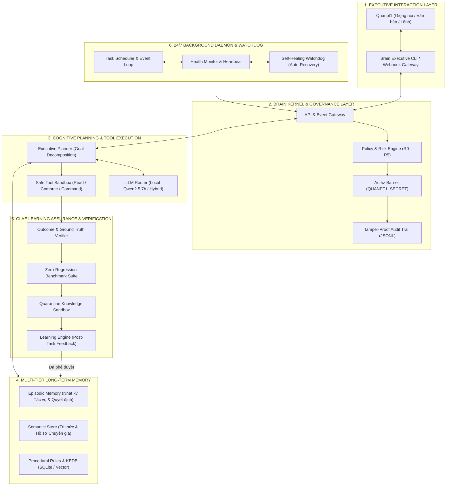

# BÁO CÁO THIẾT KẾ & XÂY DỰNG HỆ THỐNG: QUAN AI BRAIN
**Dự án:** QUAN AI BRAIN — Digital Executive Assistant  
**Mã tài liệu:** BC-QAB-ARCH-2026-V1  
**Ngày lập báo cáo:** 2026-10-17  
**Chủ nhiệm hệ thống / Người thụ hưởng:** Quanpt1  
**Đơn vị thực hiện:** AI Software Architect & Senior Engineering Pair  
**Đường dẫn lưu trữ:** [bao cao xay dung he thong](file:///e:/AI/QUAN%20AI%20BRAIN/bao%20cao%20xay%20dung%20he%20thong/BAO_CAO_XAY_DUNG_HE_THONG_QUAN_AI_BRAIN.md)  
**Tài liệu tham chiếu:** [SYSTEM_BASELINE.md](file:///e:/AI/QUAN%20AI%20BRAIN/docs/SYSTEM_BASELINE.md) | [ARCHITECTURE_GAP_ANALYSIS.md](file:///e:/AI/QUAN%20AI%20BRAIN/docs/ARCHITECTURE_GAP_ANALYSIS.md) | [NEXT_STEPS.md](file:///e:/AI/QUAN%20AI%20BRAIN/docs/NEXT_STEPS.md)

---

## MỤC LỤC
1. [TỔNG QUAN DỰ ÁN & SỨ MỆNH ĐIỀU HÀNH](#1-tổng-quan-dự-án--sứ-mệnh-điều-hành)
2. [KẾT QUẢ KIỂM TOÁN HỆ THỐNG ĐƯỜNG CƠ SỞ (SYSTEM BASELINE)](#2-kết-quả-kiểm-toán-hệ-thống-đường-cơ-sở-system-baseline)
3. [KIẾN TRÚC TỔNG THỂ ĐỀ XUẤT CHO QUAN AI BRAIN](#3-kiến-trúc-tổng-thể-đề-xuất-cho-quan-ai-brain)
4. [CHI TIẾT CÁC PHÂN HỆ CỐT LÕI](#4-chi-tiết-các-phân-hệ-cốt-lõi)
5. [KHUNG QUẢN TRỊ AN TOÀN, RỦI RO & PHÂN QUYỀN (R0 - R5)](#5-khung-quản-trị-an-toàn-rủi-ro--phân-quyền-r0---r5)
6. [ĐỘNG CƠ BẢO CHỨNG NHẬN THỨC & HỌC TỰ ĐỘNG (CLAE)](#6-động-cơ-bảo-chứng-nhận-thức--học-tự-động-clae)
7. [LỘ TRÌNH TRIỂN KHAI & TIÊU CHÍ NGHIỆM THU](#7-lộ-trình-triển-khai--tiêu-chí-nghiệm-thu)
8. [KẾ HOẠCH HÀNH ĐỘNG NGAY: SPRINT 1 (WALKING SKELETON)](#8-kế-hoạch-hành-động-ngay-sprint-1-walking-skeleton)

---

## 1. TỔNG QUAN DỰ ÁN & SỨ MỆNH ĐIỀU HÀNH

### 1.1. Bối cảnh & Định vị
**QUAN AI BRAIN** không phải là một chatbot thông thường hay một tập hợp kịch bản (scripts) đơn lẻ. Đây là **Trợ lý Điều hành Số (Digital Executive Assistant)** được thiết kế chuyên biệt để:
- Trở thành "bộ não số" đồng hành, hỗ trợ Quanpt1 trong việc chỉ đạo, theo dõi, phân tích kỹ thuật và điều hành các hệ thống AI/Data Center phức tạp.
- Tiếp nhận và xử lý yêu cầu bằng ngôn ngữ tự nhiên với sự thấu hiểu ngữ cảnh nghiệp vụ sâu sắc.
- Duy trì **trí nhớ dài hạn bền vững**, lưu giữ toàn bộ tri thức, các quyết định quan trọng, bài học kinh nghiệm và quy tắc điều hành của Quanpt1.
- Tự động lập kế hoạch, sử dụng công cụ và thực thi nhiệm vụ trong phạm vi được ủy quyền; tự dừng lại và báo cáo xin mã phê duyệt bí mật khi phát hiện rủi ro cao.
- Kiểm tra độc lập kết quả công việc trước khi báo cáo, liên tục học hỏi từ kết quả thực tế mà không gây thoái biến hệ thống (*Zero Regression*).
- Vận hành bền bỉ 24/7 dưới dạng tiến trình ngầm (Daemon) ngay cả khi người dùng không trực tuyến.

### 1.2. Các Nguyên tắc Bất biến (Core Invariants)
> [!IMPORTANT]
> 1. **Bảo tồn Nguyên trạng:** Không viết lại, di chuyển, xóa hay sửa đổi các hệ thống đang chạy (`os_kernel`, `SKILL_BAT_AI`, `BATTERY_AI_V4`, `DC-COMMAND`, `BOT`).
> 2. **Chỉ Đọc & Kiểm chứng Trước khi Can thiệp:** Mọi bước phát triển đều phải qua kiểm toán thực tế và có bài test hồi quy.
> 3. **Bảo mật Bí mật Tuyệt đối:** Không đọc, không ghi log, không hiển thị API key, mật khẩu, token hay tệp `.env`.
> 4. **Minh bạch Mã nguồn:** Mọi thay đổi mã nguồn trong workspace `e:\AI\QUAN AI BRAIN` phải xuất diff để Quanpt1 phê duyệt.
> 5. **Learning != Deployment:** Tri thức học được phải được cách ly vào vùng đệm (Quarantine Sandbox) và chỉ kích hoạt khi được kiểm chứng hoặc có sự phê duyệt của Quanpt1.

---

## 2. KẾT QUẢ KIỂM TOÁN HỆ THỐNG ĐƯỜNG CƠ SỞ (SYSTEM BASELINE)

Đợt kiểm toán hệ thống chỉ đọc vào ngày 2026-10-17 đã rà soát toàn bộ workspace và các hệ thống liên quan:

### 2.1. Hiện trạng Workspace `e:\AI\QUAN AI BRAIN`
- **Tình trạng:** Khởi tạo mới, trạng thái "Clean Slate" (sạch 100%, 0 tệp rác, chưa có Git VCS).
- **Đánh giá:** Không vướng nợ kỹ thuật (technical debt), hoàn toàn thuận lợi để thiết kế module hóa chuẩn mực theo phong cách Micro-Kernel.

### 2.2. Kiểm toán Đối chiếu Hệ thống Ngoại vi
Hệ sinh thái của Quanpt1 sở hữu các khối kiến trúc tinh hoa sẵn có trên đĩa `E:\AI`:

```
E:\AI\
├── BAT-AI-2026-Repo\battery-ai-\os_kernel\   ──> [Kernel L3: 10 Subsystems & Micro-Kernel Facade]
├── DATA CENTER AI OPERATING SYSTEM\         ──> [DC-COMMAND V6.7: CLAE 30-Step Assurance Engine]
├── Skill\SKILL_BAT_AI\                       ──> [Autonomous Workforce OS: Risk R0-R5 & Zero-Touch]
├── battery-ai-\BATTERY_AI_V4\               ──> [Experience Learning Engine & KEDB SQLite]
├── Ollama\models\                            ──> [Local LLM Engine: Qwen2.5:7b, Llama3.1, Mistral]
└── QUAN AI BRAIN\                            ──> [Workspace Trung tâm Điều hành Mới]
```

#### Chi tiết Xác minh Từng Hệ thống:
1. **DC-COMMAND V6.7 / CLAE:**
   - *Vị trí vật lý:* `E:\AI\DATA CENTER AI OPERATING SYSTEM` (và bản mirror tại `BAT-AI-2026-Repo`).
   - *Thành phần:* `core/clae.py`, `tests/test_v67_clae.py`, `DC_COMMAND_V67_CLAE_ARCHITECTURE.md`.
   - *Giá trị kế thừa:* Quy trình 30 bước phân biệt "Học thật vs May mắn" (*Luck vs Learning*), kiểm chứng hồi quy tuyệt đối (*Zero Regression*), cơ chế cách ly tri thức ứng viên.
2. **Kernel L3 (Battery OS Kernel):**
   - *Vị trí vật lý:* `E:\AI\BAT-AI-2026-Repo\battery-ai-\os_kernel`.
   - *Thành phần:* Facade `kernel.py` gắn kết 10 module độc lập: `bus` (EventBus), `policy`, `safety`, `health`, `scheduler`, `capability`, `audit`, `state`, `registry`, `api`.
   - *Giá trị kế thừa:* Mô hình Micro-Kernel hướng sự kiện, tự phục hồi (Self-Healing) và giám sát nhịp tim (Heartbeat).
3. **SKILL_BAT_AI (Autonomous AI Workforce OS):**
   - *Vị trí vật lý:* `E:\AI\Skill\SKILL_BAT_AI`.
   - *Thành phần:* Core Engine 6 khối (`TaskEngine`, `RiskEngine`, `AuthzEngine`, `ExecutionEngine`, `EscalationEngine`, `LearningEngine`), ma trận rủi ro R0 - R5, cơ chế mã phê duyệt `QUANPT1_APPROVAL_SECRET`.
   - *Giá trị kế thừa:* Khung phân loại rủi ro, phân quyền hành động và cơ chế leo thang khi gặp rủi ro cao.
4. **Battery AI V4:**
   - *Vị trí vật lý:* `E:\AI\battery-ai-\BATTERY_AI_V4`.
   - *Thành phần:* Tài liệu Master Prompts về KEDB (Known Error Database) và SQLite database.
   - *Giá trị kế thừa:* Cấu trúc lưu trữ kinh nghiệm, nguyên lý so sánh dự đoán với Ground Truth thực tế.
5. **Ollama & Local LLM:**
   - *Vị trí vật lý:* `E:\AI\Ollama`.
   - *Mô hình sẵn có:* Đã tải sẵn **`qwen2.5:7b`**, `llama3.1:latest`, `mistral:latest`.
   - *Giá trị kế thừa:* Động cơ suy luận offline bảo mật, không để lộ dữ liệu điều hành ra internet.
6. **Môi trường Python:** Máy chủ có sẵn **Python 3.11** (64-bit) và **Python 3.14.7**.

---

## 3. KIẾN TRÚC TỔNG THỂ ĐỀ XUẤT CHO QUAN AI BRAIN

QUAN AI BRAIN được thiết kế theo cấu trúc **Micro-Kernel hướng sự kiện kết hợp Động cơ Nhận thức Đa tầng (Cognitive Event-Driven Micro-Kernel)**:



---

## 4. CHI TIẾT CÁC PHÂN HỆ CỐT LÕI

### Phân hệ 1: Executive Interaction & LLM Router (`src/gateway/` & `src/llm/`)
- **Nhiệm vụ:** Tiếp nhận câu lệnh ngôn ngữ tự nhiên, phân tích ý đồ (intent classification), chuẩn hóa ngữ cảnh và chuyển tiếp vào Kernel.
- **Động cơ suy luận chính:** Sử dụng **Local Ollama `qwen2.5:7b`** cục bộ để bảo đảm 100% dữ liệu không rời khỏi máy chủ.
- **Cơ chế Fallback:** Tự động phát hiện khi dịch vụ Ollama chưa chạy, cung cấp kịch bản tự khởi động hoặc chế độ phản hồi an toàn có chỉ dẫn.

### Phân hệ 2: Trí nhớ Dài hạn Đa tầng (`src/memory/`)
Trí nhớ của QUAN AI BRAIN được chia làm 3 tầng độc lập, lưu trữ bằng **SQLite + Vector Embeddings cục bộ**:
1. **Episodic Memory (Trí nhớ Sự kiện):** Lưu toàn bộ lịch sử các tác vụ đã thực hiện, kết quả đạt được, thời gian, nguyên nhân lỗi và cách xử lý.
2. **Semantic Memory (Trí nhớ Ngữ nghĩa):** Lưu hồ sơ chuyên gia, sơ đồ các hệ thống, vai trò của từng thành phần trong DC-COMMAND, Battery-AI, thông số ngưỡng an toàn.
3. **Procedural Memory / KEDB (Trí nhớ Quy trình):** Lưu các quy tắc điều hành của Quanpt1, danh mục lỗi thường gặp và các kịch bản hành động chuẩn (SOP).

### Phân hệ 3: Lập kế hoạch & Quản trị Rủi ro (`src/planning/` & `src/governance/`)
- **Phân rã Mục tiêu (Goal Decomposition):** Tự động chia nhỏ mục tiêu phức tạp thành chuỗi các bước nguyên tử (Atomic Steps) có điều kiện tiên quyết và kiểm tra đầu ra.
- **Bộ lọc An toàn:** Mỗi bước hành động được gán nhãn rủi ro từ R0 đến R5 trước khi chuyển sang phân hệ thực thi.

### Phân hệ 4: Hộp cát Thực thi Công cụ (`src/tools/`)
- Mọi công cụ hệ thống (Đọc tệp, Ghi tệp, Chạy lệnh PowerShell, Truy vấn SQL, Gọi HTTP) đều phải được đăng ký trong `ToolRegistry`.
- Áp dụng nguyên tắc **Capability-Based Security** kế thừa từ Kernel L3:
  - Công cụ chỉ có quyền hoạt động trong phạm vi được chỉ định.
  - Cấm hoàn toàn việc can thiệp ra ngoài workspace nếu không có cờ ủy quyền rõ ràng.
  - Bộ lọc Redaction chủ động lọc bỏ mọi chuỗi nhạy cảm (token, password, key) trước khi xuất kết quả.

### Phân hệ 5: Động cơ Bảo chứng Nhận thức CLAE (`src/clae/`)
- Kế thừa trực tiếp nguyên lý từ **DC-COMMAND V6.7**:
  - **Evidence Provenance:** Mọi thông tin học được phải dẫn nguồn rõ ràng (học từ đâu, tại sao đúng, dữ liệu gốc nào chứng minh).
  - **Zero-Regression Assurance:** Kiến thức mới không bao giờ được làm hỏng các quy tắc điều hành cũ.
  - **Candidate Quarantine:** Kiến thức mới được lưu vào bảng `candidate_knowledge` và chỉ được hòa nhập vào Production Memory khi có xác nhận từ kết quả kiểm thử thực tế hoặc khi Quanpt1 cấp mã duyệt.

### Phân hệ 6: Tiến trình Nền 24/7 & Tự Phục Hồi (`src/daemon/`)
- Kế thừa từ `TaskScheduler`, `HealthMonitor` và `SelfHealingEngine` của **Kernel L3** và **SKILL_BAT_AI**:
  - Chạy vòng lặp sự kiện phi đồng bộ (Async Event Loop).
  - Tự động kiểm tra sức khỏe tiến trình mỗi 10 giây.
  - Tự giải phóng bộ nhớ khi đạt ngưỡng giới hạn, ghi nhật ký nhật ký xoay vòng (Rotating Log).
  - Tự phục hồi tác vụ dở dang dựa trên điểm kiểm tra (Checkpoints) lưu trong SQLite.

---

## 5. KHUNG QUẢN TRỊ AN TOÀN, RỦI RO & PHÂN QUYỀN (R0 - R5)

Kế thừa và hoàn thiện ma trận rủi ro từ `SKILL_BAT_AI`, phân quyền quản trị trong QUAN AI BRAIN được định nghĩa như sau:

| Cấp độ | Phân loại | Hành vi mẫu | Cơ chế Phê duyệt & Thực thi |
| :---: | :--- | :--- | :--- |
| **R0** | *Đọc & Truy vấn An toàn* | Đọc tài liệu, truy vấn SQLite, kiểm tra trạng thái dịch vụ, phân tích văn bản. | **Tự động 100%:** Thực thi ngay lập tức, ghi log kiểm toán tiêu chuẩn. |
| **R1** | *Tính toán & Lập kế hoạch* | Phân tích hồi quy, sinh phương án hành động, lập dàn ý báo cáo, đối chiếu dữ liệu. | **Tự động 100%:** Thực thi trong bộ nhớ đệm, không ảnh hưởng môi trường. |
| **R2** | *Ghi Tệp Nội bộ An toàn* | Tạo tệp báo cáo markdown trong `docs/`, lưu checkpoint trạng thái vào `ai_brain.db`. | **Tự động có kiểm tra:** Chỉ ghi trong workspace nội bộ, kiểm tra diff trước khi ghi. |
| **R3** | *Thực thi Thao tác Ngoại vi Thấp* | Gửi thông báo đến Webhook, gọi API đọc trạng thái, dọn dẹp thư mục tạm `scratch/`. | **Tự động kèm Cảnh báo:** Ghi log chuyên sâu, gửi thông báo sau khi hoàn tất. |
| **R4** | *Can thiệp Hệ thống Đáng kể* | Thay đổi cấu hình vận hành, kích hoạt tiến trình nền mới, cập nhật rule tri thức production. | **DỪNG LẠI & CHỜ DUYỆT (PENDING):** Sinh Ticket khẩn, yêu cầu Quanpt1 xác nhận. |
| **R5** | *Thao tác Nguy hiểm Cao* | Xóa dữ liệu hàng loạt, can thiệp tệp nhạy cảm, chạy script ngoài workspace, nạp mã tùy ý. | **CẤM TUYỆT ĐỐI (BLOCKED):** Từ chối tự động; chỉ có thể mở khóa bằng `QUANPT1_APPROVAL_SECRET` kèm kiểm tra chữ ký. |

---

## 6. ĐỘNG CƠ BẢO CHỨNG NHẬN THỨC & HỌC TỰ ĐỘNG (CLAE)

Kiến trúc học hỏi của QUAN AI BRAIN áp dụng quy trình chuẩn 7 bước rút gọn từ CLAE 30 bước:

```
[1. Tác vụ Hoàn tất] ──> [2. Thu thập Ground Truth] ──> [3. Đối chiếu Sai lệch]
                                                                │
[6. Cập nhật Memory] <── [5. Quanpt1 Phê duyệt] <── [4. Cách ly Candidate Knowledge]
```

1. **Thu thập Kết quả Thực tế (Ground Truth Ingestion):** Sau khi thực hiện một nhiệm vụ, Brain ghi nhận kết quả mong muốn và kết quả thực tế đạt được.
2. **Kiểm tra Sai lệch (Residual & Discrepancy Detection):** Phân tích xem kết quả đạt được là do tính toán đúng hay do ngẫu nhiên (*Luck vs Learning*).
3. **Sinh Kiến thức Ứng viên (Candidate Knowledge Generation):** Trích xuất quy tắc mới (ví dụ: *"Khi Quanpt1 yêu cầu lập báo cáo X, cần ưu tiên định dạng bảng trước biểu đồ"*).
4. **Đưa vào Vùng Cách ly (Quarantine Sandbox):** Kiến thức mới tuyệt đối không có hiệu lực ngay mà nằm ở trạng thái chờ duyệt.
5. **Kiểm tra Hồi quy (Regression Benchmark):** Chạy bài test đảm bảo kiến thức mới không xung đột với các quy tắc cốt lõi đã có.
6. **Kích hoạt Chính thức:** Chỉ khi Quanpt1 xác nhận hoặc vượt qua 3 lần kiểm chứng thành công trong môi trường sandbox thì mới nạp vào Procedural Memory.

---

## 7. LỘ TRÌNH TRIỂN KHAI & TIÊU CHÍ NGHIỆM THU

Lộ trình được chia thành 5 giai đoạn có thể kiểm thử độc lập:

```
┌────────────────────────────────────────────────────────────────────────┐
│ Giai đoạn 1: Khung Nền tảng & Môi trường (Foundation & Scaffolding)    │
│ - Khởi tạo Git, .gitignore bảo vệ secrets, virtualenv Python 3.11       │
│ - Cấu trúc module src/ và bộ test runner pytest đầu tiên               │
└───────────────────────────────────┬────────────────────────────────────┘
                                    │
┌───────────────────────────────────▼────────────────────────────────────┐
│ Giai đoạn 2: Lõi Quản trị R0-R5 & Cơ sở Dữ liệu Trí nhớ SQLite         │
│ - Xây dựng GovernanceEngine (R0-R5) và AuditTrail                      │
│ - Thiết lập Schema SQLite: Episodic, Semantic, KEDB Memory             │
└───────────────────────────────────┬────────────────────────────────────┘
                                    │
┌───────────────────────────────────▼────────────────────────────────────┐
│ Giai đoạn 3: Bộ Điều hợp LLM Cục bộ & Hộp cát Công cụ (Tool Sandbox)   │
│ - Tích hợp Adapter kết nối Ollama Qwen2.5:7b (có Mock fallback)        │
│ - Cung cấp ToolRegistry với kiểm tra quyền Capability-Based            │
└───────────────────────────────────┬────────────────────────────────────┘
                                    │
┌───────────────────────────────────▼────────────────────────────────────┐
│ Giai đoạn 4: Vòng lặp Kiểm chứng Kết quả & Tự học CLAE                 │
│ - Hiện thực hóa quy trình Ground Truth Verification                    │
│ - Xây dựng vùng đệm Quarantine và bộ kiểm thử hồi quy tự động          │
└───────────────────────────────────┬────────────────────────────────────┘
                                    │
┌───────────────────────────────────▼────────────────────────────────────┐
│ Giai đoạn 5: Tiến trình Chạy ngầm 24/7 & Tự Phục Hồi (Daemon)           │
│ - Khởi chạy Daemon Runner với Heartbeat Monitor & Self-Healing         │
│ - Xây dựng kịch bản Start/Stop an toàn và giám sát tiến trình          │
└────────────────────────────────────────────────────────────────────────┘
```

---

## 8. KẾ HOẠCH HÀNH ĐỘNG NGAY: SPRINT 1 (WALKING SKELETON)

Để bắt đầu một cách vững chắc, an toàn và có thể kiểm thử ngay lập tức, Sprint 1 sẽ thiết lập **Bộ xương tối thiểu (The Walking Skeleton)**:

### 8.1. Các Bước Thực thi Cụ thể:
1. **Khởi tạo Kho lưu trữ Git & Tệp Bảo vệ Bí mật:**
   - Chạy `git init` trong `e:\AI\QUAN AI BRAIN`.
   - Tạo tệp `.gitignore` chuẩn hóa ngăn chặn hoàn toàn việc theo dõi: `.venv/`, `__pycache__/`, `*.db`, `.env`, `*.log`, `*.key`.
2. **Thiết lập Môi trường Cô lập:**
   - Tạo môi trường ảo `.venv` với Python 3.11.
   - Cài đặt gói kiểm thử tiêu chuẩn `pytest`.
3. **Tạo Cấu trúc Thư mục Module Chuẩn:**
   ```
   QUAN AI BRAIN/
   ├── bao cao xay dung he thong/
   │   └── BAO_CAO_XAY_DUNG_HE_THONG_QUAN_AI_BRAIN.md
   ├── docs/
   │   ├── SYSTEM_BASELINE.md
   │   ├── ARCHITECTURE_GAP_ANALYSIS.md
   │   └── NEXT_STEPS.md
   ├── src/
   │   ├── __init__.py
   │   ├── core/           # Khung Kernel Facade & Audit Log
   │   ├── governance/     # Ma trận rủi ro R0 - R5
   │   ├── memory/         # Lõi lưu trữ SQLite
   │   ├── planning/       # Phân rã mục tiêu
   │   ├── tools/          # Tool Registry & Capability
   │   ├── clae/           # Động cơ bảo chứng học tập
   │   └── daemon/         # Vòng lặp ngầm 24/7
   ├── tests/
   │   ├── __init__.py
   │   └── test_smoke.py   # Kiểm tra môi trường và tính toàn vẹn
   ├── pyproject.toml
   └── README.md
   ```
4. **Viết Bài Kiểm thử Smoke Test Đầu tiên (`tests/test_smoke.py`):**
   - Xác nhận import toàn bộ package `src`.
   - Kiểm tra khả năng tạo cơ sở dữ liệu SQLite trong bộ nhớ và ghi/đọc nhật ký.
   - Kiểm tra bộ lọc Redaction khử mật khẩu/token thành công.

### 8.2. Tiêu chí Hoàn thành Sprint 1 (Definition of Done):
- [x] Bản báo cáo thiết kế hệ thống được lưu hoàn chỉnh tại `e:\AI\QUAN AI BRAIN\bao cao xay dung he thong\`.
- [ ] Lệnh `git status` thể hiện trạng thái sạch sẽ, đúng quy ước `.gitignore`.
- [ ] Lệnh `pytest tests/` hoàn tất với 100% test case passed.
- [ ] Tuyệt đối không can thiệp ra ngoài workspace, không tạo rủi ro cho các hệ thống xung quanh.

---
*Bản báo cáo đã được lưu trữ an toàn tại thư mục yêu cầu và sẵn sàng để Quanpt1 phê duyệt triển khai Sprint 1.*
