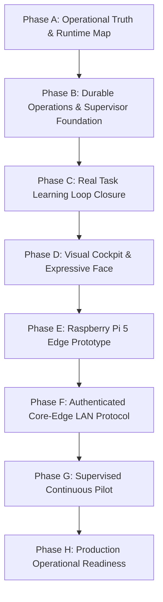

# QUAN AI BRAIN — LỘ TRÌNH VẬN HÀNH LIÊN TỤC & TỰ NÂNG CẤP BỀN VỮNG
## CONTINUOUS OPERATIONS & SELF-LEARNING EVOLUTION ROADMAP (PHASE A ĐẾN PHASE H)

- **Chủ nhân & Người phê chuẩn:** Quanpt1
- **Vị thế hệ thống:** Digital Executive Assistant — Bản sao điều hành số có năng lực tự học và phục hồi
- **Nguyên tắc tối thượng:** `AGENTS.md` (Fail-closed, không tự ý cấp quyền, R5 chặn cứng, R4 cần chữ ký số)
- **Tài liệu tham chiếu:** [reports/QUAN_AI_BRAIN_OPERATIONAL_AUDIT_20261019_184000.md](file:///e:/AI/QUAN%20AI%20BRAIN/reports/QUAN_AI_BRAIN_OPERATIONAL_AUDIT_20261019_184000.md)

---

## I. TỔNG QUAN CHIẾN LƯỢC

Mục tiêu của QUAN AI BRAIN không phải là một tập hợp các tệp mã nguồn thụ động chờ người dùng ra lệnh, mà phát triển thành một **Hệ điều hành trợ lý số tự vận hành liên tục (Continuous Autonomy OS)** với chu trình chuẩn tắc:

```
┌────────────────────────────────────────────────────────────────────────┐
│                                                                        │
│   OBSERVE ──► THINK ──► PLAN ──► ACT WITH AUTHORIZATION ──► VERIFY     │
│      ▲                                                        │        │
│      │                                                        ▼        │
│   CONTINUE ◄── REPORT ◄── IMPROVE ◄── PROPOSE UPGRADE ◄── LEARN        │
│                                                                        │
└────────────────────────────────────────────────────────────────────────┘
```

Trong đó:
- **PC là Central Brain Core:** Nắm giữ toàn bộ trí nhớ dài hạn, mô hình ngôn ngữ lớn, máy trạng thái điều phối, chính sách quản trị và kho lưu trữ bằng chứng.
- **Quanpt1 là Owner tối cao:** Mọi hành động can thiệp mã nguồn (Level C), thay đổi cấu hình sản xuất hoặc tích hợp ngoại vi (Level D / R4) đều phải có sự chấp thuận rõ ràng của Quanpt1 qua Phòng Điều Hành Cổng 8766.
- **An toàn tuyệt đối:** R5 bị chặn cứng vô điều kiện. STOP/FREEZE có hiệu lực tức thời. Không có bất kỳ đường bypass nào.

---

## II. LỘ TRÌNH 8 GIAI ĐOẠN CHI TIẾT (PHASES A – H)



---

### Giai đoạn A: Xác thực Hiện trạng & Bản đồ Vận hành (ĐÃ HOÀN THÀNH)
- **Mục tiêu:** Kiểm toán toàn diện 12 câu hỏi sự thật, đo lường 267 bài test thực tế, kiểm kê tiến trình mạng (ports 8766, 8765, 11434).
- **Kết quả:** Đã xuất bản báo cáo [reports/QUAN_AI_BRAIN_OPERATIONAL_AUDIT_20261019_184000.md](file:///e:/AI/QUAN%20AI%20BRAIN/reports/QUAN_AI_BRAIN_OPERATIONAL_AUDIT_20261019_184000.md).

### Giai đoạn B: Sổ Nhiệm Vụ Bền Vững & Máy Trạng Thái Supervisor (ĐÃ HOÀN THÀNH)
- **Mục tiêu:** Khắc phục điểm nghẽn mất dữ liệu sau restart bằng sổ lưu trữ nhiệm vụ bền vững và bộ điều phối 16 trạng thái.
- **Kết quả nghiệm thu:**
  - `DurableTaskRegistry` (`data/tasks.db`): Quản lý vòng đời `TaskRecord`, chống chạy trùng với `idempotency_key`, tự động chuyển task dở dang sang `OUTCOME_UNKNOWN` khi restart.
  - `ContinuousAutonomySupervisor`: Máy trạng thái 16 bước, phân luồng Level A tự chạy vs Level B/C/D dừng chờ duyệt.
  - Đạt **267 / 267 tests PASS (100%)** với 17 bài test mới.

---

### Giai đoạn C: Đóng Kín Vòng Học Tập Thực Tế (TIẾP THEO)
- **Vấn đề cần giải quyết:** Hiện tại `PeriodicLearningReporter` vẫn phải bấm nút thủ công và lấy task lỗi mẫu giả lập.
- **Kế hoạch triển khai:**
  1. Tích hợp `DurableTaskRegistry` trực tiếp vào `PeriodicLearningReporter`: Khi có một task thật trong `data/tasks.db` bị `FAILED` hoặc gặp `OUTCOME_UNKNOWN`, Learning Engine tự động trích xuất nguyên nhân thất bại và đặt câu hỏi nghiên cứu.
  2. Bổ sung `EvaluationBenchmarkHarness`: Xây dựng bộ 10 tác vụ chuẩn mực đa lĩnh vực (tra cứu trí nhớ, lập kế hoạch DAG, phát hiện lỗ hổng quyền hạn, khôi phục sau sự cố) để đo lường tỷ lệ hoàn thành tác vụ trước và sau khi kích hoạt một bài học mới.
  3. Chỉ cho phép đề xuất nâng cấp nếu chỉ số đo lường thực tế chứng minh có tiến bộ rõ ràng.
- **Tiêu chuẩn an toàn:** Tri thức mới tiếp tục được cách ly tại `CANDIDATE` và chỉ nạp vào bộ nhớ hoạt động khi Quanpt1 bấm duyệt trên Port 8766.

---

### Giai đoạn D: Visual Cockpit & Expressive Face (PC Dashboard)
- **Vấn đề cần giải quyết:** Giao diện điều hành trên port 8766 hiện tại còn dạng bảng điều khiển quản trị tĩnh, chưa trực quan hóa trạng thái "sống" của Brain.
- **Kế hoạch triển khai:**
  1. **Digital Avatar (Expressive Face):** Thiết kế nhân vật số với các biểu cảm trạng thái hình học SVG hiện đại:
     - `IDLE`: Thư thái, nhấp nháy mắt nhẹ.
     - `LISTENING`: Mắt sáng mở rộng, vòng sóng âm chuyển động.
     - `THINKING`: Ánh sáng quét ngang, biểu thị đang suy luận DAG.
     - `RESEARCHING`: Biểu tượng radar quét tài liệu.
     - `LEARNING`: Vòng xoay phân tích tri thức cách ly.
     - `SPEAKING`: Miệng hoặc sóng âm dao động theo âm lượng giọng nói.
     - `WAITING_FOR_OWNER`: Màu hổ phách nhấp nháy chậm, chờ Quanpt1 chỉ đạo.
     - `BLOCKED` / `SAFE_MODE`: Màu đỏ hoặc lam bảo vệ, hiển thị rào chắn.
  2. **Activity & Task Stream:** Hiển thị trực tiếp danh sách nhiệm vụ từ `DurableTaskRegistry` và trạng thái chuyển đổi của `ContinuousAutonomySupervisor`.
  3. **Learning Cockpit Widget:** Theo dõi chu kỳ học gần nhất, số lượng candidate đang cách ly và các đề xuất nâng cấp đang chờ quyết định.

---

### Giai đoạn E: Raspberry Pi 5 Edge Interface Prototype
- **Vấn đề cần giải quyết:** Mở rộng trải nghiệm trợ lý ra không gian vật lý (đặt tại bàn làm việc của Quanpt1).
- **Kế hoạch triển khai:**
  1. Xây dựng ứng dụng Edge Kiosk nhẹ chạy trên Raspberry Pi OS (sử dụng màn hình cảm ứng DSI hoặc HDMI 5-7 inch).
  2. Hiển thị phiên bản rút gọn của Expressive Face đồng bộ với PC Brain Core.
  3. Micro thu âm giọng nói với từ khóa đánh thức ("Tony ơi", "Hi TONY").
  4. Loa phát âm thanh phản hồi TTS.
  5. Nút bấm vật lý hoặc cảm ứng ngắt micro phần cứng (Hardware Privacy Mute).
- **Nguyên tắc bất biến:** Raspberry Pi 5 **CHỈ LÀ THIẾT BỊ GIAO TIẾP (PERIPHERAL EDGE)**. Toàn bộ cơ sở dữ liệu, model LLM, logic lập kế hoạch và quyền hạn đều nằm tại PC Brain Core.

---

### Giai đoạn F: Giao Thức Mạng Xác Thực Core – Edge (LAN Protocol)
- **Vấn đề cần giải quyết:** Kết nối an toàn giữa Raspberry Pi 5 và PC trong mạng nội bộ gia đình/văn phòng.
- **Kế hoạch triển khai:**
  1. Quy trình ghép cặp 1 lần (One-Time Pairing) qua mã PIN hiển thị trên màn hình PC.
  2. Xác thực bằng Bearer Token mã hóa kèm chữ ký HMAC thời gian thực chống phát lại (Anti-Replay Nonce).
  3. Cấu hình Windows Firewall chỉ cho phép đúng IP của Raspberry Pi 5 kết nối vào cổng dịch vụ Core.
  4. Nếu mất kết nối mạng: Màn hình Pi 5 lập tức báo *"Mất kết nối với Brain Core"*, chuyển sang trạng thái an toàn thụ động, tuyệt đối không tự ý ra lệnh.

---

### Giai đoạn G: Thử Nghiệm Vận Hành Liên Tục Có Giám Sát (Supervised Pilot)
- **Điều kiện tiên quyết:** Phải có văn bản phê duyệt riêng từ Quanpt1.
- **Quy mô thử nghiệm:**
  1. Giới hạn khung thời gian: 2 giờ hoặc 8 giờ trong ngày.
  2. Giới hạn tài nguyên: Tối đa 2GB RAM, không vượt quá 30% CPU máy chủ.
  3. Giới hạn hành động: Chỉ thực hiện các tác vụ đọc, kiểm tra sức khỏe hệ thống, rà soát lỗi và nghiên cứu tài liệu nội bộ (Level A).
  4. Chế độ dừng tức thì: Nút bấm STOP trên Port 8766 hoặc lệnh giọng nói "Dừng lại" lập tức hạ lệnh ngắt máy trạng thái trong 0.1 giây.

---

### Giai đoạn H: Sẵn Sàng Vận Hành Sản Xuất 24/7 (Production Operational Readiness)
- Chỉ được xem xét sau khi:
  1. Toàn bộ các Phase từ A đến G đạt 100% tiêu chí nghiệm thu bằng chứng.
  2. Báo cáo đánh giá an toàn bảo mật và rà soát quyền hạn được Quanpt1 ký duyệt chính thức.
  3. Có cơ chế giám sát tiến trình ngoài (External Watchdog) độc lập chống treo và có phương án rollback 1 chạm.

---

## III. BẢNG TIÊU CHÍ NGHIỆM THU MỖI GIAI ĐOẠN

| Giai đoạn | Tiêu chí kỹ thuật bắt buộc | Minh chứng cần có | Trạng thái hiện tại |
|---|---|---|:---:|
| **Phase A** | Kiểm toán 12 câu hỏi sự thật, kiểm tra 3 cổng mạng | Báo cáo `reports/QUAN_AI_BRAIN_OPERATIONAL_AUDIT_*.md` | **ĐÃ HOÀN THÀNH** |
| **Phase B** | Sổ nhiệm vụ SQLite WAL, máy trạng thái 16 bước, chống lặp | 267/267 tests pass, phục hồi `OUTCOME_UNKNOWN` khi restart | **ĐÃ HOÀN THÀNH** |
| **Phase C** | Nối task thật vào chu trình tự học, benchmark đa tác vụ | Test tự học đóng kín từ `durable_tasks`, chỉ số before/after | **SẴN SÀNG THIẾT KẾ** |
| **Phase D** | Visual Cockpit trên port 8766, Expressive Avatar 10 trạng thái | Giao diện SVG động, đồng bộ state thời gian thực từ Supervisor | **SẴN SÀNG THIẾT KẾ** |
| **Phase E** | Client giao tiếp giọng nói trên Pi 5, chế độ kiosk | Giao diện Edge hiển thị avatar, micro thu wake-word | **THIẾT KẾ KIẾN TRÚC** |
| **Phase F** | Ghép cặp thiết bị bảo mật, chống nghe lén và replay | Token mã hóa HMAC, whitelist IP Windows Firewall | **THIẾT KẾ KIẾN TRÚC** |
| **Phase G** | Vận hành liên tục trong khung giờ được duyệt (dry-run/Level A) | Báo cáo chu kỳ vận hành, log kiểm toán, STOP/FREEZE test | **CHỜ DUYỆT PHÁT TRIỂN** |
| **Phase H** | Hoạt động thường trực ổn định, tự phục hồi sau sự cố | Đánh giá an toàn toàn diện, biên bản nghiệm thu của Quanpt1 | **DÀI HẠN** |
