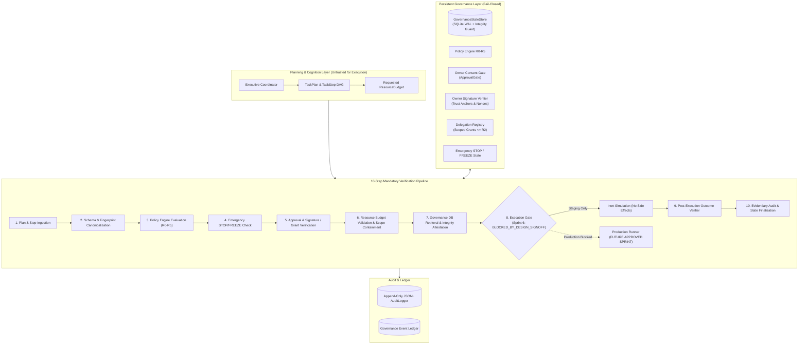
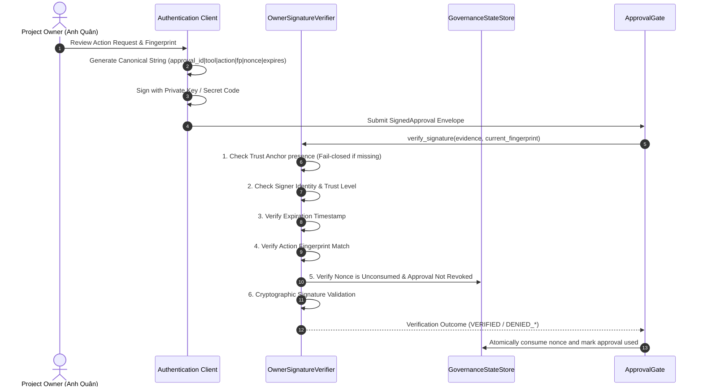

# QUAN AI BRAIN — Production Execution Readiness & Supervised Staging Design

> **Document Version:** 1.0.0 (Sprint 6)  
> **Status:** `DESIGN_SPECIFICATION — PENDING_OWNER_SIGNOFF`  
> **Authority:** Project Owner (Anh Quân)  
> **Scope:** Architecture Specification for Future Isolated Execution Runner, OS Resource Budget Policy, and Owner Signature Verification Gate.  
> **Zero-Execution Invariant:** This document defines architectural specifications only. No production execution runners, OS subprocess spawners, external write APIs, or 24/7 background Windows services are activated.

---

## 1. Executive Summary & Purpose

Sprint 5 established a persistent governance state store (`GovernanceStateStore` in SQLite WAL mode) and an inert staging executor (`IsolatedStagingExecutor`). Sprint 6 advances the system toward production execution readiness by defining:
1. **The 10-Step Mandatory Execution Pipeline:** A strictly sequential, non-bypassable verification chain separating planning from execution.
2. **Owner Signature Verification Architecture:** Cryptographic verification model evaluating trust anchors, public key management, replay nonces, and action fingerprint bindings.
3. **OS Resource Budget Policy:** Strict application-level and OS-level resource boundaries (CPU, memory, runtime, output bytes, child process count, network policy) preventing denial-of-service and runaway loops.
4. **Isolated Runner Staging Framework:** A containment model preventing unapproved actions from altering any production system or sibling workspace.

In this Sprint, all components operate in **INERT / DRY-RUN / VALIDATION ONLY** mode. Step 8 of the execution pipeline stops at staging and returns `BLOCKED_BY_DESIGN_SIGNOFF` whenever production execution is requested.

---

## 2. System Architecture & Component Interactions

---

## 3. The 10-Step Mandatory Processing Sequence

Execution readiness demands that no action reach an operating system runner without passing the 10 sequential gates in order:

| Step | Gate Name | Subsystem | Failure Behavior | Description |
| :--- | :--- | :--- | :--- | :--- |
| **1** | Plan Ingestion | `ExecutiveCoordinator` | Reject Plan | Ingest `TaskPlan` and `TaskStep`. Validate DAG structure and uniqueness of step IDs. |
| **2** | Canonicalization | `PathGuard` & Fingerprinting | Reject Step | Compute deterministic SHA-256 action fingerprint over `tool_id`, `action`, sanitized parameters, and `resource_scope`. |
| **3** | Policy Engine | `PolicyEngine` | Block / Wait Approval | Classify risk (R0–R5). R5 is hard-blocked immediately. R4 escalates to mandatory Dual-Factor owner approval. |
| **4** | Emergency Check | `GovernanceStateStore` | `BLOCKED_EMERGENCY` | Check persistent emergency state. If `STOP` or `FREEZE` is active, halt all actions immediately. |
| **5** | Consent Verification | `ApprovalGate` & `OwnerSignatureVerifier` | `DENIED_APPROVAL` | Verify explicit owner approval with cryptographic signature/OTP, or an active delegation grant matching tool, risk ceiling, and scope. |
| **6** | Budget Validation | `ResourceBudgetValidator` | `DENIED_BUDGET` | Validate runtime, memory, CPU, process count, output bytes, and network policy against system ceiling and delegation grant. |
| **7** | Governance Integrity | `GovernanceStateStore.verify_integrity()` | `FAIL_CLOSED` | Ensure SQLite WAL database is integral, schema version is current, and nonces are fresh. DB error raises `GovernanceStateCorruptError`. |
| **8** | Execution Dispatch | `IsolatedStagingExecutor` | `BLOCKED_BY_DESIGN_SIGNOFF` | **In Sprint 6: Strictly inert simulation.** Production runner raises `ProductionExecutionProhibitedError`. |
| **9** | Outcome Verification | Post-Execution Outcome Verifier | Mark Failed | Validate post-conditions, output schemas, and check for unexpected filesystem modifications. |
| **10** | Evidentiary Audit | `AuditLogger` & Store | Audit Record | Record outcome, redact parameters, mark single-use approval/nonce consumed in atomic transaction. |

> [!CRITICAL]
> Under no circumstances may an LLM self-certify that safety conditions are met or bypass any of the 10 steps. Every gate is evaluated by deterministic standard-library code independent of the LLM.

---

## 4. Component Architectural Roles

### 4.1 Executive Coordinator & TaskPlan/TaskStep
- **Role:** Generates candidate plans from user goals.
- **Security Boundary:** Untrusted for authorization. All plans and steps generated by the coordinator are subject to independent policy re-evaluation before execution staging.

### 4.2 GovernanceStateStore
- **Role:** Persistent source of truth in SQLite WAL mode.
- **Stored Entities:**
  - `emergency_states`: Persistent `STOP` and `FREEZE` records surviving reboots.
  - `approvals`: State transitions (`pending_owner_approval`, `approved`, `consumed`, `revoked`).
  - `consumed_nonces`: Anti-replay single-use nonce registry.
  - `delegation_grants`: Active, expired, and revoked delegation grants.
  - `governance_events`: Append-only governance ledger.
- **Fail-Closed Guarantee:** Any database corruption, schema mismatch, or read error immediately blocks all tool operations.

### 4.3 Policy Engine R0–R5
- **R0 (Read-Only Diagnostics):** Safe, bounded information retrieval (`dir_list`, `git_status`, `memory_read`, `system_health`).
- **R1 (Low Risk / Internal Validation):** Workspace-only validation (`plan_validate`).
- **R2 (Moderate Risk / Workspace Modification):** Workspace-confined new file creation (`file_write_new`). Overwrite forbidden. Max delegation ceiling.
- **R3 (High Risk / Production Query / Batch Ops):** Non-delegatable. Requires explicit owner consent.
- **R4 (Critical Risk / Configuration / System Mutation):** Non-delegatable. Mandatory Dual-Factor owner approval (Owner Secret Code HMAC + SMS OTP).
- **R5 (Prohibited Risk / Unbounded / External Destruction):** Unconditionally hard-blocked (`BLOCKED_R5_PROHIBITED`). Zero override secrets.

### 4.4 Owner Consent Gate & Owner Signature Verifier
- **Role:** Cryptographically verifies that the action was explicitly approved by the human owner.
- **Channels:**
  - Channel 1: Owner Private Secret Code (HMAC-SHA256 signature over canonical payload).
  - Channel 2: Out-of-band 6-digit SMS OTP challenge with short TTL and attempt limiter.
  - Dual-Factor: Both channels mandatory for R4.
  - Signature Verifier: Asymmetric / trust-anchor signature verification adapter (`OwnerSignatureVerifier`).

### 4.5 Delegation Registry
- **Role:** Manages bounded autonomous execution within strict limits.
- **10-Point Governance Bounds:** Grant ID, grantor, tool IDs, action types, resource path, project scope, risk ceiling ($\le$ R2), expiry, call budget, and revocation check.

### 4.6 Resource Budget Controller
- **Role:** Evaluates and enforces task-level resource envelopes (`ResourceBudget`).
- **Validated Boundaries:**
  - `max_runtime_seconds`: Enforces wall-clock timeout.
  - `max_memory_mb`: Enforces memory usage ceiling.
  - `max_cpu_time_seconds`: Enforces CPU time limit.
  - `max_output_bytes`: Limits captured stdout/stderr (e.g. 100KB).
  - `max_child_processes`: Staging/inert allows 0. Production max 1.
  - `max_tool_calls`: Limits recursive tool executions.
  - `max_retries`: Prevents runaway retry loops.
  - `network_policy`: Strict confinement (`BLOCKED`, `LOCALHOST_ONLY`).

### 4.7 Post-Execution Outcome Verifier & AuditLogger
- **Role:** Validates post-execution state against expected side effects and writes tamper-evident audit logs.
- Redacts secrets and credentials before logging.

---

## 5. Owner Signature Verification Architecture

### 5.1 Public Key & Trust Anchor Management
- **Trust Anchor Definition:** A trust anchor is an explicit, pre-configured public key or cryptographic secret configured out-of-band by the project owner.
- **Fail-Closed Default:** If no trust anchor is configured, all signature verifications fail immediately (`DENIED_NO_TRUST_ANCHOR`).
- **Zero In-Code Secrets:** Private keys and secret codes are NEVER stored in source code, repositories, configuration files committed to Git, or audit logs.
- **Key Rotation & Lifecycle:** Public keys have explicit valid-from and valid-to timestamps. Retired keys cannot sign new requests.
- **Revocation List:** Public keys or specific key IDs can be revoked immediately via `GovernanceStateStore.revoke_approval()`.

---

## 6. OS-Level Containment Roadmap (Future Production Runner)

While Sprint 6 enforces application-level validation via `ResourceBudgetValidator`, actual OS-level isolation for future production execution will utilize:
1. **Windows Job Objects (`CreateJobObjectW`, `SetInformationJobObject`):**
   - `JOB_OBJECT_LIMIT_KILL_ON_JOB_CLOSE`: Automatically terminates child processes if runner crashes.
   - `JOB_OBJECT_LIMIT_PROCESS_MEMORY`: Hard physical memory cap per process.
   - `JOB_OBJECT_LIMIT_JOB_MEMORY`: Hard aggregate memory cap across all spawned processes.
   - `JOB_OBJECT_LIMIT_ACTIVE_PROCESS`: Enforces `max_child_processes` at kernel level.
   - `JOB_OBJECT_LIMIT_PROCESS_TIME`: Hard user-mode CPU time cap.
2. **Restricted Token / AppContainer:**
   - Drop administrative privileges and strip write access to system directories.
   - Restrict filesystem access to workspace subdirectories only.
3. **Firewall / Network Isolation:**
   - Windows Filtering Platform (WFP) rules blocking outbound socket connections except loopback (`127.0.0.1`).

---

## 7. Protected External Repositories (Strict Isolation)

The following sibling systems remain strictly preserved and must never be touched, modified, or written to:
- `E:\AI\DATA CENTER AI OPERATING SYSTEM` (DC-COMMAND V6.7 / CLAE)
- `E:\AI\BAT-AI-2026-Repo\battery-ai-\os_kernel` (Kernel L3)
- `E:\AI\Skill\SKILL_BAT_AI` (AI Workforce OS)
- `E:\AI\battery-ai-\BATTERY_AI_V4` (Battery Intelligence Brain)
- `E:\AI\BOT` (Active production bots)
- VDCIM, NetChat, and associated production databases.

---

## 8. Staging Verification & Sign-Off Requirement

In Sprint 6:
- The staging executor is **STRICTLY INERT** (`is_inert = True`, `supports_production = False`).
- Production execution requests raise `ProductionExecutionProhibitedError`.
- Transitioning from inert staging to supervised production execution requires explicit owner sign-off on [docs/SPRINT6_DESIGN_SIGNOFF.md](file:///E:/AI/QUAN%20AI%20BRAIN/docs/SPRINT6_DESIGN_SIGNOFF.md) and [docs/SPRINT5_DESIGN_SIGNOFF.md](file:///E:/AI/QUAN%20AI%20BRAIN/docs/SPRINT5_DESIGN_SIGNOFF.md).
