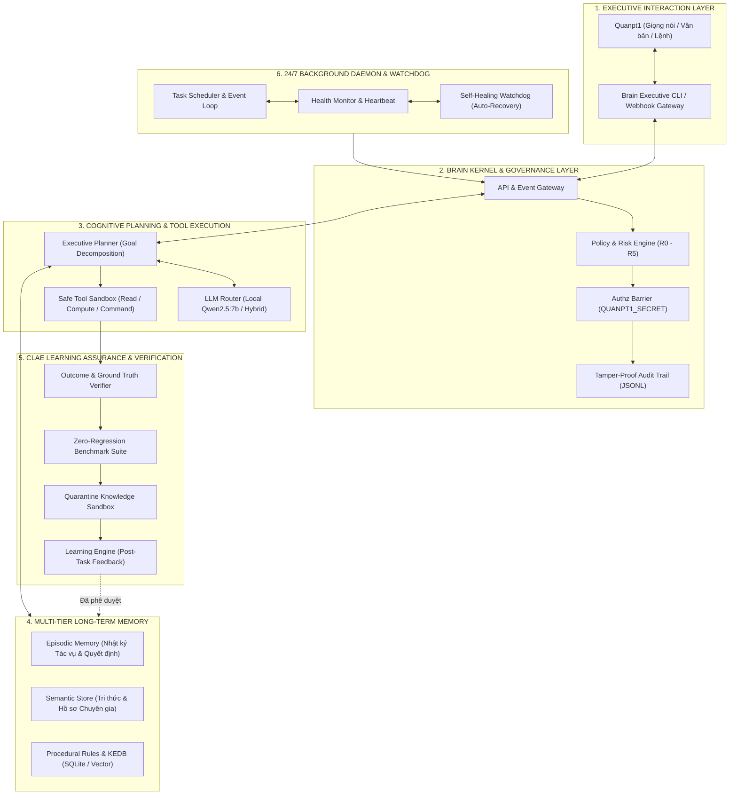

# QUAN AI BRAIN — Automated Handoff Report

> Báo cáo được tạo tự động bởi `tools/validate_and_report.py`. Đây là trạng thái đọc được từ workspace tại thời điểm chạy; không đại diện cho việc xác minh hệ thống ngoại vi nếu chưa có test tích hợp.

## 1. Phiên báo cáo
- UTC timestamp: `2026-10-17T14:53:02.833662+00:00`
- Workspace: `E:\AI\QUAN AI BRAIN`
- Python: `3.11.9`
- OS: `Windows-10-10.0.19045-SP0`
- Report generator: `tools/validate_and_report.py`

## 2. Kết quả kiểm thử
- Verdict: **PASS**
- Command: `E:\AI\QUAN AI BRAIN\.venv\Scripts\python.exe -m pytest -q tests`
```text
................                                                         [100%]
16 passed in 0.10s
```

## 3. Git status
```text
Git repository chưa được khởi tạo hoặc Git không sẵn sàng.
```

## 4. Cấu trúc module đã kiểm tra
- `core`: directory exists
- `governance`: directory exists
- `memory`: directory exists
- `planning`: directory exists
- `tools`: directory exists
- `clae`: directory exists
- `daemon`: directory exists

## 5. Danh mục tệp an toàn trong workspace
> Chỉ liệt kê đường dẫn tương đối và kích thước. Tệp bí mật, DB, log, dữ liệu runtime và thư mục build bị loại khỏi báo cáo.
- `.gitignore` — 392 bytes
- `AGENTS.md` — 2803 bytes
- `QUAN_AI_BRAIN_SPRINT1_STARTER.zip` — 29866 bytes
- `README_SPRINT1.md` — 4500 bytes
- `pyproject.toml` — 646 bytes
- `bao cao xay dung he thong/ANTIGRAVITY_APPLY_PROMPT.md` — 1632 bytes
- `bao cao xay dung he thong/BAO_CAO_XAY_DUNG_HE_THONG_QUAN_AI_BRAIN.md` — 23986 bytes
- `bao cao xay dung he thong/QUAN_AI_BRAIN_SPRINT1_BUILD_VALIDATION_EXAMPLE.md` — 16608 bytes
- `bao cao xay dung he thong/README.md` — 1492 bytes
- `docs/ANTIGRAVITY_APPLY_PROMPT.md` — 1632 bytes
- `docs/ANTIGRAVITY_WORKFLOW.md` — 1500 bytes
- `docs/ARCHITECTURE_GAP_ANALYSIS.md` — 11037 bytes
- `docs/NEXT_STEPS.md` — 8247 bytes
- `docs/PROJECT_STATUS.md` — 1725 bytes
- `docs/SYSTEM_BASELINE.md` — 8796 bytes
- `docs/WORKSPACE_MERGE_INSTRUCTIONS.md` — 2293 bytes
- `src/quan_ai_brain/__init__.py` — 73 bytes
- `src/quan_ai_brain/cli.py` — 2095 bytes
- `src/quan_ai_brain/clae/__init__.py` — 41 bytes
- `src/quan_ai_brain/clae/quarantine.py` — 1871 bytes
- `src/quan_ai_brain/core/__init__.py` — 41 bytes
- `src/quan_ai_brain/core/audit.py` — 1141 bytes
- `src/quan_ai_brain/core/redaction.py` — 1735 bytes
- `src/quan_ai_brain/daemon/__init__.py` — 43 bytes
- `src/quan_ai_brain/daemon/health.py` — 754 bytes
- `src/quan_ai_brain/governance/__init__.py` — 47 bytes
- `src/quan_ai_brain/governance/policy.py` — 2684 bytes
- `src/quan_ai_brain/memory/__init__.py` — 43 bytes
- `src/quan_ai_brain/memory/sqlite_store.py` — 8347 bytes
- `src/quan_ai_brain/planning/__init__.py` — 45 bytes
- `src/quan_ai_brain/planning/models.py` — 1504 bytes
- `src/quan_ai_brain/tools/__init__.py` — 42 bytes
- `src/quan_ai_brain/tools/path_guard.py` — 1155 bytes
- `src/quan_ai_brain.egg-info/PKG-INFO` — 4921 bytes
- `src/quan_ai_brain.egg-info/SOURCES.txt` — 1044 bytes
- `src/quan_ai_brain.egg-info/dependency_links.txt` — 1 bytes
- `src/quan_ai_brain.egg-info/entry_points.txt` — 57 bytes
- `src/quan_ai_brain.egg-info/requires.txt` — 25 bytes
- `src/quan_ai_brain.egg-info/top_level.txt` — 14 bytes
- `tests/test_memory.py` — 970 bytes
- `tests/test_path_and_audit.py` — 1005 bytes
- `tests/test_planning_and_health.py` — 724 bytes
- `tests/test_policy.py` — 1440 bytes
- `tests/test_quarantine.py` — 2302 bytes
- `tests/test_redaction.py` — 631 bytes
- `tools/merge_starter_safely.py` — 4590 bytes
- `tools/validate_and_report.py` — 11942 bytes

## 6. Trạng thái dự án được người phát triển khai báo
# QUAN AI BRAIN — Project Status

## Current milestone
Sprint 1 — Safety-first walking skeleton.

## Status as shipped in this starter package
- [x] Policy engine skeleton R0–R5; R5 hard-blocked.
- [x] SQLite episodic memory and candidate knowledge quarantine.
- [x] Basic redaction for common credential patterns before logging.
- [x] Workspace path guard.
- [x] JSONL audit logger.
- [x] CLI self-check and local memory smoke commands.
- [x] Automated test-and-handoff report script.
- [ ] Apply the package to the actual Windows workspace.
- [ ] Run tests on the Dell Precision 7550 and attach a new handoff report.
- [ ] Initialize Git in the actual workspace after checking for an existing repository.
- [ ] Audit baseline and confirm no changes outside `E:\AI\QUAN AI BRAIN`.
- [ ] Integrate Ollama only after Sprint 1 is accepted.

## Not implemented / not verified
- Ollama runtime connection or LLM fallback.
- Integration with Kernel L3, DC-COMMAND / CLAE, SKILL_BAT_AI, Battery AI V4, VDCIM or NetChat.
- Windows service or always-on daemon.
- Vector embeddings, semantic search, voice interface, or autonomous production execution.

## Safety decisions
- R5 is blocked in this implementation. Do not add an override secret to the source code.
- R4 requires an external approval process; no production executor is implemented yet.
- Learning candidates stay quarantined until separately approved and regression-verified.
- Current audit/report utility does not scan outside the project root and does not read secret/database files.

## How to update status
Update this file only when a change is implemented and test evidence exists. Then run `tools/validate_and_report.py` to generate a new handoff report.

## 7. Tài liệu dự án được đưa vào gói bàn giao
> Chỉ các tài liệu Markdown có tên nằm trong danh sách cho phép mới được đính kèm. Tài liệu được lọc mẫu bí mật phổ biến; tuyệt đối không lưu token hoặc mật khẩu trong tài liệu dự án.

### Source document: `AGENTS.md`

# QUAN AI BRAIN — Persistent Engineering Rules

## Mission
Build QUAN AI BRAIN as a safety-first Digital Executive Assistant with persistent memory, auditable planning, bounded tool use, evidence-based verification, and owner-controlled learning.

## Non-negotiable constraints
- Work only inside this QUAN AI BRAIN workspace unless the owner explicitly authorizes a specific external target.
- Preserve `os_kernel`, `SKILL_BAT_AI`, `BATTERY_AI_V4`, `DC-COMMAND`, BOT projects, and all other sibling systems. Do not edit them directly.
- Never open, print, copy, or log secret values. Do not read `.env`, credentials stores, private keys/certificates, production databases, or environment variables for reporting.
- Do not add hard-coded credentials or an override secret. R5 remains hard-blocked.
- R4 requires separately verified owner approval. If an authenticated approval verifier is not configured, do not implement or simulate approval.
- Do not add real production executors, write APIs, device control, or a Windows 24/7 service without an explicit reviewed design and approval.
- Learning is not deployment. New knowledge must remain quarantined until evidence, regression tests, and the configured owner-approval path all pass.
- Never claim a feature is implemented, integrated, or verified merely because a file exists.

## Work procedure
1. Read `docs/PROJECT_STATUS.md` and the existing architecture/baseline documents before each significant change.
2. Propose the smallest safe, testable change and identify which files it will touch.
3. Inspect existing files and show a diff before replacing or overwriting them.
4. Make changes only after the plan is accepted. Prefer standard-library code until additional dependencies are justified.
5. Run focused tests; after reviewing the diff, run `python tools/validate_and_report.py`.
6. Confirm that `reports/HANDOFF_LATEST.md` exists and truthfully records the test outcome, changed files, project inventory, current status, relevant source documentation, unresolved issues, and next steps.
7. Report the handoff file path and a concise summary to the owner. The owner must upload that report back to ChatGPT to continue work with continuity.
8. Update `docs/PROJECT_STATUS.md` only when supported by test evidence. Keep implemented, tested, inferred, and not implemented states distinct.
9. If tests fail, the report must still be generated, the failure must remain visible, and no release or production action may occur.

## Current milestone
Sprint 1 safety-first walking skeleton. The initial package has not yet been validated on the owner's Windows machine. Ollama, Kernel L3, DC-COMMAND/CLAE, SKILL_BAT_AI, Battery AI V4, VDCIM, NetChat, voice, vector search, and always-on daemon integration are not yet verified by this package.

### Source document: `bao cao xay dung he thong/ANTIGRAVITY_APPLY_PROMPT.md`

# Prompt to apply the Sprint 1 starter in Antigravity

Paste the following instruction into Antigravity after adding the extracted starter files to the reviewed `E:\AI\QUAN AI BRAIN` workspace. Do not grant it access to the parent `E:\AI` folder as a workspace.

---

You are working on QUAN AI BRAIN. First inspect the current workspace and read `AGENTS.md`, `docs/PROJECT_STATUS.md`, `docs/WORKSPACE_MERGE_INSTRUCTIONS.md`, and the existing baseline/architecture documents. Compare the staged Sprint 1 starter files with the current project. Do not overwrite any existing files automatically and do not touch sibling projects. Show me a merge plan and conflicts before applying changes.

After the merge is explicitly approved:
1. Check whether `.git` or `.venv` already exists before suggesting creation or replacement.
2. Use the project's Python 3.11 environment if available; do not change the machine-wide Python installation.
3. Run the Sprint 1 tests and resolve failures only within this workspace.
4. Verify the report generator excludes secrets, databases, runtime logs, and files outside this project.
5. Review the code diff and run `python tools/validate_and_report.py`.
6. Open `reports/HANDOFF_LATEST.md` and confirm it reports the real Windows workspace, actual test results, source documents, known gaps, and next steps. Do not claim hardware/integration checks were done unless tests prove them.
7. Return the report path, test count/result, changed files, unresolved issues, and next safe milestone. Stop if you find a conflicting existing file, a secret-like file, or any intended write outside the workspace.

### Source document: `bao cao xay dung he thong/BAO_CAO_XAY_DUNG_HE_THONG_QUAN_AI_BRAIN.md`

# BÁO CÁO THIẾT KẾ & XÂY DỰNG HỆ THỐNG: QUAN AI BRAIN
**Dự án:** QUAN AI BRAIN — Digital Executive Assistant  
**Mã tài liệu:** BC-QAB-ARCH-2026-V1  
**Ngày lập báo cáo:** 2026-10-17  
**Chủ nhiệm hệ thống / Người thụ hưởng:** Quanpt1  
**Đơn vị thực hiện:** AI Software Architect & Senior Engineering Pair  
**Đường dẫn lưu trữ:** [bao cao xay dung he thong](file:///e:/AI/QUAN%20AI%20BRAIN/bao%20cao%20xay%20dung%20he%20thong/BAO_CAO_XAY_DUNG_HE_THONG_QUAN_AI_BRAIN.md)  
**Tài liệu tham chiếu:** [SYSTEM_BASELINE.md](file:///e:/AI/QUAN%20AI%20BRAIN/docs/SYSTEM_BASELINE.md) | [ARCHITECTURE_GAP_ANALYSIS.md](file:///e:/AI/QUAN%20AI%20BRAIN/docs/ARCHITECTURE_GAP_ANALYSIS.md) | [NEXT_STEPS.md](file:///e:/AI/QUAN%20AI%20BRAIN/docs/NEXT_STEPS.md)

---

## MỤC LỤC
1. [TỔNG QUAN DỰ ÁN & SỨ MỆNH ĐIỀU HÀNH](#1-tổng-quan-dự-án--sứ-mệnh-điều-hành)
2. [KẾT QUẢ KIỂM TOÁN HỆ THỐNG ĐƯỜNG CƠ SỞ (SYSTEM BASELINE)](#2-kết-quả-kiểm-toán-hệ-thống-đường-cơ-sở-system-baseline)
3. [KIẾN TRÚC TỔNG THỂ ĐỀ XUẤT CHO QUAN AI BRAIN](#3-kiến-trúc-tổng-thể-đề-xuất-cho-quan-ai-brain)
4. [CHI TIẾT CÁC PHÂN HỆ CỐT LÕI](#4-chi-tiết-các-phân-hệ-cốt-lõi)
5. [KHUNG QUẢN TRỊ AN TOÀN, RỦI RO & PHÂN QUYỀN (R0 - R5)](#5-khung-quản-trị-an-toàn-rủi-ro--phân-quyền-r0---r5)
6. [ĐỘNG CƠ BẢO CHỨNG NHẬN THỨC & HỌC TỰ ĐỘNG (CLAE)](#6-động-cơ-bảo-chứng-nhận-thức--học-tự-động-clae)
7. [LỘ TRÌNH TRIỂN KHAI & TIÊU CHÍ NGHIỆM THU](#7-lộ-trình-triển-khai--tiêu-chí-nghiệm-thu)
8. [KẾ HOẠCH HÀNH ĐỘNG NGAY: SPRINT 1 (WALKING SKELETON)](#8-kế-hoạch-hành-động-ngay-sprint-1-walking-skeleton)

---

## 1. TỔNG QUAN DỰ ÁN & SỨ MỆNH ĐIỀU HÀNH

### 1.1. Bối cảnh & Định vị
**QUAN AI BRAIN** không phải là một chatbot thông thường hay một tập hợp kịch bản (scripts) đơn lẻ. Đây là **Trợ lý Điều hành Số (Digital Executive Assistant)** được thiết kế chuyên biệt để:
- Trở thành "bộ não số" đồng hành, hỗ trợ Quanpt1 trong việc chỉ đạo, theo dõi, phân tích kỹ thuật và điều hành các hệ thống AI/Data Center phức tạp.
- Tiếp nhận và xử lý yêu cầu bằng ngôn ngữ tự nhiên với sự thấu hiểu ngữ cảnh nghiệp vụ sâu sắc.
- Duy trì **trí nhớ dài hạn bền vững**, lưu giữ toàn bộ tri thức, các quyết định quan trọng, bài học kinh nghiệm và quy tắc điều hành của Quanpt1.
- Tự động lập kế hoạch, sử dụng công cụ và thực thi nhiệm vụ trong phạm vi được ủy quyền; tự dừng lại và báo cáo xin mã phê duyệt bí mật khi phát hiện rủi ro cao.
- Kiểm tra độc lập kết quả công việc trước khi báo cáo, liên tục học hỏi từ kết quả thực tế mà không gây thoái biến hệ thống (*Zero Regression*).
- Vận hành bền bỉ 24/7 dưới dạng tiến trình ngầm (Daemon) ngay cả khi người dùng không trực tuyến.

### 1.2. Các Nguyên tắc Bất biến (Core Invariants)
> [!IMPORTANT]
> 1. **Bảo tồn Nguyên trạng:** Không viết lại, di chuyển, xóa hay sửa đổi các hệ thống đang chạy (`os_kernel`, `SKILL_BAT_AI`, `BATTERY_AI_V4`, `DC-COMMAND`, `BOT`).
> 2. **Chỉ Đọc & Kiểm chứng Trước khi Can thiệp:** Mọi bước phát triển đều phải qua kiểm toán thực tế và có bài test hồi quy.
> 3. **Bảo mật Bí mật Tuyệt đối:** Không đọc, không ghi log, không hiển thị API key, mật khẩu, token hay tệp `.env`.
> 4. **Minh bạch Mã nguồn:** Mọi thay đổi mã nguồn trong workspace `e:\AI\QUAN AI BRAIN` phải xuất diff để Quanpt1 phê duyệt.
> 5. **Learning != Deployment:** Tri thức học được phải được cách ly vào vùng đệm (Quarantine Sandbox) và chỉ kích hoạt khi được kiểm chứng hoặc có sự phê duyệt của Quanpt1.

---

## 2. KẾT QUẢ KIỂM TOÁN HỆ THỐNG ĐƯỜNG CƠ SỞ (SYSTEM BASELINE)

Đợt kiểm toán hệ thống chỉ đọc vào ngày 2026-10-17 đã rà soát toàn bộ workspace và các hệ thống liên quan:

### 2.1. Hiện trạng Workspace `e:\AI\QUAN AI BRAIN`
- **Tình trạng:** Khởi tạo mới, trạng thái "Clean Slate" (sạch 100%, 0 tệp rác, chưa có Git VCS).
- **Đánh giá:** Không vướng nợ kỹ thuật (technical debt), hoàn toàn thuận lợi để thiết kế module hóa chuẩn mực theo phong cách Micro-Kernel.

### 2.2. Kiểm toán Đối chiếu Hệ thống Ngoại vi
Hệ sinh thái của Quanpt1 sở hữu các khối kiến trúc tinh hoa sẵn có trên đĩa `E:\AI`:

```
E:\AI\
├── BAT-AI-2026-Repo\battery-ai-\os_kernel\   ──> [Kernel L3: 10 Subsystems & Micro-Kernel Facade]
├── DATA CENTER AI OPERATING SYSTEM\         ──> [DC-COMMAND V6.7: CLAE 30-Step Assurance Engine]
├── Skill\SKILL_BAT_AI\                       ──> [Autonomous Workforce OS: Risk R0-R5 & Zero-Touch]
├── battery-ai-\BATTERY_AI_V4\               ──> [Experience Learning Engine & KEDB SQLite]
├── Ollama\models\                            ──> [Local LLM Engine: Qwen2.5:7b, Llama3.1, Mistral]
└── QUAN AI BRAIN\                            ──> [Workspace Trung tâm Điều hành Mới]
```

#### Chi tiết Xác minh Từng Hệ thống:
1. **DC-COMMAND V6.7 / CLAE:**
   - *Vị trí vật lý:* `E:\AI\DATA CENTER AI OPERATING SYSTEM` (và bản mirror tại `BAT-AI-2026-Repo`).
   - *Thành phần:* `core/clae.py`, `tests/test_v67_clae.py`, `DC_COMMAND_V67_CLAE_ARCHITECTURE.md`.
   - *Giá trị kế thừa:* Quy trình 30 bước phân biệt "Học thật vs May mắn" (*Luck vs Learning*), kiểm chứng hồi quy tuyệt đối (*Zero Regression*), cơ chế cách ly tri thức ứng viên.
2. **Kernel L3 (Battery OS Kernel):**
   - *Vị trí vật lý:* `E:\AI\BAT-AI-2026-Repo\battery-ai-\os_kernel`.
   - *Thành phần:* Facade `kernel.py` gắn kết 10 module độc lập: `bus` (EventBus), `policy`, `safety`, `health`, `scheduler`, `capability`, `audit`, `state`, `registry`, `api`.
   - *Giá trị kế thừa:* Mô hình Micro-Kernel hướng sự kiện, tự phục hồi (Self-Healing) và giám sát nhịp tim (Heartbeat).
3. **SKILL_BAT_AI (Autonomous AI Workforce OS):**
   - *Vị trí vật lý:* `E:\AI\Skill\SKILL_BAT_AI`.
   - *Thành phần:* Core Engine 6 khối (`TaskEngine`, `RiskEngine`, `AuthzEngine`, `ExecutionEngine`, `EscalationEngine`, `LearningEngine`), ma trận rủi ro R0 - R5, cơ chế mã phê duyệt `QUANPT1_APPROVAL_SECRET`.
   - *Giá trị kế thừa:* Khung phân loại rủi ro, phân quyền hành động và cơ chế leo thang khi gặp rủi ro cao.
4. **Battery AI V4:**
   - *Vị trí vật lý:* `E:\AI\battery-ai-\BATTERY_AI_V4`.
   - *Thành phần:* Tài liệu Master Prompts về KEDB (Known Error Database) và SQLite database.
   - *Giá trị kế thừa:* Cấu trúc lưu trữ kinh nghiệm, nguyên lý so sánh dự đoán với Ground Truth thực tế.
5. **Ollama & Local LLM:**
   - *Vị trí vật lý:* `E:\AI\Ollama`.
   - *Mô hình sẵn có:* Đã tải sẵn **`qwen2.5:7b`**, `llama3.1:latest`, `mistral:latest`.
   - *Giá trị kế thừa:* Động cơ suy luận offline bảo mật, không để lộ dữ liệu điều hành ra internet.
6. **Môi trường Python:** Máy chủ có sẵn **Python 3.11** (64-bit) và **Python 3.14.7**.

---

## 3. KIẾN TRÚC TỔNG THỂ ĐỀ XUẤT CHO QUAN AI BRAIN

QUAN AI BRAIN được thiết kế theo cấu trúc **Micro-Kernel hướng sự kiện kết hợp Động cơ Nhận thức Đa tầng (Cognitive Event-Driven Micro-Kernel)**:



---

## 4. CHI TIẾT CÁC PHÂN HỆ CỐT LÕI

### Phân hệ 1: Executive Interaction & LLM Router (`src/gateway/` & `src/llm/`)
- **Nhiệm vụ:** Tiếp nhận câu lệnh ngôn ngữ tự nhiên, phân tích ý đồ (intent classification), chuẩn hóa ngữ cảnh và chuyển tiếp vào Kernel.
- **Động cơ suy luận chính:** Sử dụng **Local Ollama `qwen2.5:7b`** cục bộ để bảo đảm 100% dữ liệu không rời khỏi máy chủ.
- **Cơ chế Fallback:** Tự động phát hiện khi dịch vụ Ollama chưa chạy, cung cấp kịch bản tự khởi động hoặc chế độ phản hồi an toàn có chỉ dẫn.

### Phân hệ 2: Trí nhớ Dài hạn Đa tầng (`src/memory/`)
Trí nhớ của QUAN AI BRAIN được chia làm 3 tầng độc lập, lưu trữ bằng **SQLite + Vector Embeddings cục bộ**:
1. **Episodic Memory (Trí nhớ Sự kiện):** Lưu toàn bộ lịch sử các tác vụ đã thực hiện, kết quả đạt được, thời gian, nguyên nhân lỗi và cách xử lý.
2. **Semantic Memory (Trí nhớ Ngữ nghĩa):** Lưu hồ sơ chuyên gia, sơ đồ các hệ thống, vai trò của từng thành phần trong DC-COMMAND, Battery-AI, thông số ngưỡng an toàn.
3. **Procedural Memory / KEDB (Trí nhớ Quy trình):** Lưu các quy tắc điều hành của Quanpt1, danh mục lỗi thường gặp và các kịch bản hành động chuẩn (SOP).

### Phân hệ 3: Lập kế hoạch & Quản trị Rủi ro (`src/planning/` & `src/governance/`)
- **Phân rã Mục tiêu (Goal Decomposition):** Tự động chia nhỏ mục tiêu phức tạp thành chuỗi các bước nguyên tử (Atomic Steps) có điều kiện tiên quyết và kiểm tra đầu ra.
- **Bộ lọc An toàn:** Mỗi bước hành động được gán nhãn rủi ro từ R0 đến R5 trước khi chuyển sang phân hệ thực thi.

### Phân hệ 4: Hộp cát Thực thi Công cụ (`src/tools/`)
- Mọi công cụ hệ thống (Đọc tệp, Ghi tệp, Chạy lệnh PowerShell, Truy vấn SQL, Gọi HTTP) đều phải được đăng ký trong `ToolRegistry`.
- Áp dụng nguyên tắc **Capability-Based Security** kế thừa từ Kernel L3:
  - Công cụ chỉ có quyền hoạt động trong phạm vi được chỉ định.
  - Cấm hoàn toàn việc can thiệp ra ngoài workspace nếu không có cờ ủy quyền rõ ràng.
  - Bộ lọc Redaction chủ động lọc bỏ mọi chuỗi nhạy cảm (token, password, key) trước khi xuất kết quả.

### Phân hệ 5: Động cơ Bảo chứng Nhận thức CLAE (`src/clae/`)
- Kế thừa trực tiếp nguyên lý từ **DC-COMMAND V6.7**:
  - **Evidence Provenance:** Mọi thông tin học được phải dẫn nguồn rõ ràng (học từ đâu, tại sao đúng, dữ liệu gốc nào chứng minh).
  - **Zero-Regression Assurance:** Kiến thức mới không bao giờ được làm hỏng các quy tắc điều hành cũ.
  - **Candidate Quarantine:** Kiến thức mới được lưu vào bảng `candidate_knowledge` và chỉ được hòa nhập vào Production Memory khi có xác nhận từ kết quả kiểm thử thực tế hoặc khi Quanpt1 cấp mã duyệt.

### Phân hệ 6: Tiến trình Nền 24/7 & Tự Phục Hồi (`src/daemon/`)
- Kế thừa từ `TaskScheduler`, `HealthMonitor` và `SelfHealingEngine` của **Kernel L3** và **SKILL_BAT_AI**:
  - Chạy vòng lặp sự kiện phi đồng bộ (Async Event Loop).
  - Tự động kiểm tra sức khỏe tiến trình mỗi 10 giây.
  - Tự giải phóng bộ nhớ khi đạt ngưỡng giới hạn, ghi nhật ký nhật ký xoay vòng (Rotating Log).
  - Tự phục hồi tác vụ dở dang dựa trên điểm kiểm tra (Checkpoints) lưu trong SQLite.

---

## 5. KHUNG QUẢN TRỊ AN TOÀN, RỦI RO & PHÂN QUYỀN (R0 - R5)

Kế thừa và hoàn thiện ma trận rủi ro từ `SKILL_BAT_AI`, phân quyền quản trị trong QUAN AI BRAIN được định nghĩa như sau:

| Cấp độ | Phân loại | Hành vi mẫu | Cơ chế Phê duyệt & Thực thi |
| :---: | :--- | :--- | :--- |
| **R0** | *Đọc & Truy vấn An toàn* | Đọc tài liệu, truy vấn SQLite, kiểm tra trạng thái dịch vụ, phân tích văn bản. | **Tự động 100%:** Thực thi ngay lập tức, ghi log kiểm toán tiêu chuẩn. |
| **R1** | *Tính toán & Lập kế hoạch* | Phân tích hồi quy, sinh phương án hành động, lập dàn ý báo cáo, đối chiếu dữ liệu. | **Tự động 100%:** Thực thi trong bộ nhớ đệm, không ảnh hưởng môi trường. |
| **R2** | *Ghi Tệp Nội bộ An toàn* | Tạo tệp báo cáo markdown trong `docs/`, lưu checkpoint trạng thái vào `ai_brain.db`. | **Tự động có kiểm tra:** Chỉ ghi trong workspace nội bộ, kiểm tra diff trước khi ghi. |
| **R3** | *Thực thi Thao tác Ngoại vi Thấp* | Gửi thông báo đến Webhook, gọi API đọc trạng thái, dọn dẹp thư mục tạm `scratch/`. | **Tự động kèm Cảnh báo:** Ghi log chuyên sâu, gửi thông báo sau khi hoàn tất. |
| **R4** | *Can thiệp Hệ thống Đáng kể* | Thay đổi cấu hình vận hành, kích hoạt tiến trình nền mới, cập nhật rule tri thức production. | **DỪNG LẠI & CHỜ DUYỆT (PENDING):** Sinh Ticket khẩn, yêu cầu Quanpt1 xác nhận. |
| **R5** | *Thao tác Nguy hiểm Cao* | Xóa dữ liệu hàng loạt, can thiệp tệp nhạy cảm, chạy script ngoài workspace, nạp mã tùy ý. | **CẤM TUYỆT ĐỐI (BLOCKED):** Từ chối tự động; chỉ có thể mở khóa bằng `QUANPT1_APPROVAL_SECRET` kèm kiểm tra chữ ký. |

---

## 6. ĐỘNG CƠ BẢO CHỨNG NHẬN THỨC & HỌC TỰ ĐỘNG (CLAE)

Kiến trúc học hỏi của QUAN AI BRAIN áp dụng quy trình chuẩn 7 bước rút gọn từ CLAE 30 bước:

```
[1. Tác vụ Hoàn tất] ──> [2. Thu thập Ground Truth] ──> [3. Đối chiếu Sai lệch]
                                                                │
[6. Cập nhật Memory] <── [5. Quanpt1 Phê duyệt] <── [4. Cách ly Candidate Knowledge]
```

1. **Thu thập Kết quả Thực tế (Ground Truth Ingestion):** Sau khi thực hiện một nhiệm vụ, Brain ghi nhận kết quả mong muốn và kết quả thực tế đạt được.
2. **Kiểm tra Sai lệch (Residual & Discrepancy Detection):** Phân tích xem kết quả đạt được là do tính toán đúng hay do ngẫu nhiên (*Luck vs Learning*).
3. **Sinh Kiến thức Ứng viên (Candidate Knowledge Generation):** Trích xuất quy tắc mới (ví dụ: *"Khi Quanpt1 yêu cầu lập báo cáo X, cần ưu tiên định dạng bảng trước biểu đồ"*).
4. **Đưa vào Vùng Cách ly (Quarantine Sandbox):** Kiến thức mới tuyệt đối không có hiệu lực ngay mà nằm ở trạng thái chờ duyệt.
5. **Kiểm tra Hồi quy (Regression Benchmark):** Chạy bài test đảm bảo kiến thức mới không xung đột với các quy tắc cốt lõi đã có.
6. **Kích hoạt Chính thức:** Chỉ khi Quanpt1 xác nhận hoặc vượt qua 3 lần kiểm chứng thành công trong môi trường sandbox thì mới nạp vào Procedural Memory.

---

## 7. LỘ TRÌNH TRIỂN KHAI & TIÊU CHÍ NGHIỆM THU

Lộ trình được chia thành 5 giai đoạn có thể kiểm thử độc lập:

```
┌────────────────────────────────────────────────────────────────────────┐
│ Giai đoạn 1: Khung Nền tảng & Môi trường (Foundation & Scaffolding)    │
│ - Khởi tạo Git, .gitignore bảo vệ secrets, virtualenv Python 3.11       │
│ - Cấu trúc module src/ và bộ test runner pytest đầu tiên               │
└───────────────────────────────────┬────────────────────────────────────┘
                                    │
┌───────────────────────────────────▼────────────────────────────────────┐
│ Giai đoạn 2: Lõi Quản trị R0-R5 & Cơ sở Dữ liệu Trí nhớ SQLite         │
│ - Xây dựng GovernanceEngine (R0-R5) và AuditTrail                      │
│ - Thiết lập Schema SQLite: Episodic, Semantic, KEDB Memory             │
└───────────────────────────────────┬────────────────────────────────────┘
                                    │
┌───────────────────────────────────▼────────────────────────────────────┐
│ Giai đoạn 3: Bộ Điều hợp LLM Cục bộ & Hộp cát Công cụ (Tool Sandbox)   │
│ - Tích hợp Adapter kết nối Ollama Qwen2.5:7b (có Mock fallback)        │
│ - Cung cấp ToolRegistry với kiểm tra quyền Capability-Based            │
└───────────────────────────────────┬────────────────────────────────────┘
                                    │
┌───────────────────────────────────▼────────────────────────────────────┐
│ Giai đoạn 4: Vòng lặp Kiểm chứng Kết quả & Tự học CLAE                 │
│ - Hiện thực hóa quy trình Ground Truth Verification                    │
│ - Xây dựng vùng đệm Quarantine và bộ kiểm thử hồi quy tự động          │
└───────────────────────────────────┬────────────────────────────────────┘
                                    │
┌───────────────────────────────────▼────────────────────────────────────┐
│ Giai đoạn 5: Tiến trình Chạy ngầm 24/7 & Tự Phục Hồi (Daemon)           │
│ - Khởi chạy Daemon Runner với Heartbeat Monitor & Self-Healing         │
│ - Xây dựng kịch bản Start/Stop an toàn và giám sát tiến trình          │
└────────────────────────────────────────────────────────────────────────┘
```

---

## 8. KẾ HOẠCH HÀNH ĐỘNG NGAY: SPRINT 1 (WALKING SKELETON)

Để bắt đầu một cách vững chắc, an toàn và có thể kiểm thử ngay lập tức, Sprint 1 sẽ thiết lập **Bộ xương tối thiểu (The Walking Skeleton)**:

### 8.1. Các Bước Thực thi Cụ thể:
1. **Khởi tạo Kho lưu trữ Git & Tệp Bảo vệ Bí mật:**
   - Chạy `git init` trong `e:\AI\QUAN AI BRAIN`.
   - Tạo tệp `.gitignore` chuẩn hóa ngăn chặn hoàn toàn việc theo dõi: `.venv/`, `__pycache__/`, `*.db`, `.env`, `*.log`, `*.key`.
2. **Thiết lập Môi trường Cô lập:**
   - Tạo môi trường ảo `.venv` với Python 3.11.
   - Cài đặt gói kiểm thử tiêu chuẩn `pytest`.
3. **Tạo Cấu trúc Thư mục Module Chuẩn:**
   ```
   QUAN AI BRAIN/
   ├── bao cao xay dung he thong/
   │   └── BAO_CAO_XAY_DUNG_HE_THONG_QUAN_AI_BRAIN.md
   ├── docs/
   │   ├── SYSTEM_BASELINE.md
   │   ├── ARCHITECTURE_GAP_ANALYSIS.md
   │   └── NEXT_STEPS.md
   ├── src/
   │   ├── __init__.py
   │   ├── core/           # Khung Kernel Facade & Audit Log
   │   ├── governance/     # Ma trận rủi ro R0 - R5
   │   ├── memory/         # Lõi lưu trữ SQLite
   │   ├── planning/       # Phân rã mục tiêu
   │   ├── tools/          # Tool Registry & Capability


[TRUNCATED: document exceeded the per-file handoff limit]

### Source document: `docs/ANTIGRAVITY_APPLY_PROMPT.md`

# Prompt to apply the Sprint 1 starter in Antigravity

Paste the following instruction into Antigravity after adding the extracted starter files to the reviewed `E:\AI\QUAN AI BRAIN` workspace. Do not grant it access to the parent `E:\AI` folder as a workspace.

---

You are working on QUAN AI BRAIN. First inspect the current workspace and read `AGENTS.md`, `docs/PROJECT_STATUS.md`, `docs/WORKSPACE_MERGE_INSTRUCTIONS.md`, and the existing baseline/architecture documents. Compare the staged Sprint 1 starter files with the current project. Do not overwrite any existing files automatically and do not touch sibling projects. Show me a merge plan and conflicts before applying changes.

After the merge is explicitly approved:
1. Check whether `.git` or `.venv` already exists before suggesting creation or replacement.
2. Use the project's Python 3.11 environment if available; do not change the machine-wide Python installation.
3. Run the Sprint 1 tests and resolve failures only within this workspace.
4. Verify the report generator excludes secrets, databases, runtime logs, and files outside this project.
5. Review the code diff and run `python tools/validate_and_report.py`.
6. Open `reports/HANDOFF_LATEST.md` and confirm it reports the real Windows workspace, actual test results, source documents, known gaps, and next steps. Do not claim hardware/integration checks were done unless tests prove them.
7. Return the report path, test count/result, changed files, unresolved issues, and next safe milestone. Stop if you find a conflicting existing file, a secret-like file, or any intended write outside the workspace.

### Source document: `docs/ANTIGRAVITY_WORKFLOW.md`

# Antigravity workflow for QUAN AI BRAIN

At the end of each work session, the coding agent must:

1. Restrict file changes to the `QUAN AI BRAIN` workspace unless the owner explicitly approves otherwise.
2. Show the proposed diff before applying changes that affect existing files.
3. Never open, echo, copy, or report secret values from `.env`, keys, certificates, credential stores, databases, or environment variables.
4. Run the smallest relevant tests, then run:
   `python tools/validate_and_report.py`
5. Review `reports/HANDOFF_LATEST.md` and verify that it truthfully distinguishes implemented, tested, inferred, and not implemented features.
6. Provide the owner the report file path, test summary, changed-file summary, known failures, risks, and next recommended task.
7. Do not state a test passed unless output shows it passed. Do not state integration is complete until the actual external system has been tested.

## Standard handoff prompt

"Review the current QUAN AI BRAIN code and project status. Work only on the next smallest safe and testable increment. Do not touch sibling projects, do not open or log secrets, and do not run production-changing tools. Before modifying existing files, show the plan and diff. After changes, run tests and `python tools/validate_and_report.py`. Ensure `reports/HANDOFF_LATEST.md` includes the true test result, changed files, implementation status, unresolved issues, and next steps. Stop and report if evidence or permissions are missing."

### Source document: `docs/ARCHITECTURE_GAP_ANALYSIS.md`

# ARCHITECTURE GAP ANALYSIS: QUAN AI BRAIN
**Document ID:** DOC-QAB-GAP-001  
**Audit Date:** 2026-10-17  
**Auditor / Role:** AI Software Architect & Senior Engineer  
**Target Goal:** Digital Executive Assistant (Trợ lý Điều hành Số Toàn diện)  
**Workspace:** `e:\AI\QUAN AI BRAIN`

---

## 1. Tầm nhìn Kiến trúc Mục tiêu
QUAN AI BRAIN được định vị là một **Trợ lý Điều hành Số (Digital Executive Assistant)** cấp cao dành riêng cho Quanpt1, sở hữu các năng lực then chốt:
1. **Tiếp nhận & Thấu hiểu tự nhiên:** Giao tiếp qua ngôn ngữ tự nhiên, phân tách ngữ cảnh chỉ đạo điều hành.
2. **Trí nhớ dài hạn đa tầng (Multi-tier Long-term Memory):** Lưu trữ và truy xuất tri thức, quyết định, quy tắc nghiệp vụ, lịch sử kinh nghiệm và bài học đã xác minh.
3. **Lập kế hoạch & Thực thi có kiểm soát (Planning & Authorized Execution):** Phân rã mục tiêu thành lộ trình hành động; tự động thực thi các tác vụ trong phạm vi được ủy quyền; dừng lại xin phê duyệt khi gặp rủi ro cao.
4. **Kiểm chứng kết quả độc lập (Outcome Verification & Self-Check):** Kiểm tra tính đúng đắn trước khi bàn giao; tự động kiểm tra hồi quy; chống ngẫu nhiên.
5. **Học tập liên tục từ kinh nghiệm (Cognitive Continuous Learning):** Tích lũy tri thức mới sau mỗi nhiệm vụ thành công hoặc sau khi được con người điều chỉnh, tuân thủ nguyên tắc cách ly an toàn (*Learning != Direct Deployment*).
6. **Vận hành bền bỉ 24/7 (Resilient Background Daemon):** Hoạt động liên tục, tự phục hồi khi có sự cố, không phụ thuộc vào trạng thái mở giao diện của người dùng.

---

## 2. Phân tích Khoảng cách (Gap Analysis) theo Khối Chức năng

```
                     MỤC TIÊU: QUAN AI BRAIN (EXECUTIVE ASSISTANT)
┌──────────────────────────────────────────────────────────────────────────────────┐
│                             Executive Gateway & API                              │
├─────────────────────┬──────────────────────┬─────────────────────────────────────┤
│  1. Memory Engine   │ 2. Planning & Authz  │ 3. Execution & Tool Sandbox         │
│  - Episodic Memory  │ - Goal Decomposition │ - Tool Registry                     │
│  - Semantic Store   │ - Risk Matrix R0-R5  │ - Pre/Post Execution Validation     │
│  - Experience DB    │ - Approval Escalation│ - Idempotent Actions                │
├─────────────────────┴──────────────────────┴─────────────────────────────────────┤
│                        4. Cognitive Learning Engine                              │
│         - CLAE 30-Step Assurance Pipeline (Evidence Provenance, Zero Regression) │
├──────────────────────────────────────────────────────────────────────────────────┤
│                        5. Background Daemon & Kernel                             │
│         - Event Bus, Task Scheduler, Health Monitor, Self-Healing Watchdog       │
└──────────────────────────────────────────────────────────────────────────────────┘
```

### Bảng Đối chiếu: Hiện trạng vs Khoảng cách vs Giải pháp Tận dụng Hệ thống Có sẵn

| Khối Chức năng | Hiện trạng Workspace `QUAN AI BRAIN` | Tài nguyên Hệ thống Hiện hữu Liên quan | Khoảng cách Kỹ thuật (Gap) | Giải pháp Kiến trúc Kế thừa |
| :--- | :--- | :--- | :--- | :--- |
| **1. Tiếp nhận Ngôn ngữ & Suy luận** | Chưa có | Ollama đã cài đặt tại `E:\AI\Ollama` với model `qwen2.5:7b` sẵn có trên đĩa. | Thiếu client adapter kết nối với Ollama; thiếu fallback xử lý khi model bận hoặc offline. | Xây dựng `LLMProvider` hỗ trợ cả Local Ollama (Qwen2.5:7b) và Cloud API (nếu cần), có fallback và timeout an toàn. |
| **2. Trí nhớ Dài hạn (Memory Engine)** | Chưa có | - `BATTERY_AI_V4` có cấu trúc KEDB & SQLite.<br>- `SKILL_BAT_AI` có `ai_workforce.db`.<br>- CLAE có 7-Layer Extended Memory. | Chưa có lược đồ cơ sở dữ liệu (schema) chuẩn cho Executive Memory (ghi nhớ quyết định điều hành, tri thức của Quanpt1). | Thiết kế SQLite/DuckDB + Vector Index cục bộ cho 3 tầng nhớ: Episodic (nhật ký việc làm), Semantic (tri thức), Procedural (quy tắc điều hành). |
| **3. Lập kế hoạch & Đánh giá Rủi ro** | Chưa có | `SKILL_BAT_AI` đã có sẵn ma trận rủi ro `RiskEngine` (R0-R5) và hàng rào phân quyền `AuthzEngine`. | Các rule hiện tại của SKILL_BAT_AI đang gắn liền với nghiệp vụ pin/hạ tầng, chưa tổng quát hóa cho Trợ lý Điều hành. | Kế thừa nguyên lý R0-R5 của `RiskEngine` và cơ chế bí mật `QUANPT1_APPROVAL_SECRET`, trừu tượng hóa thành `BrainGovernanceEngine`. |
| **4. Thực thi & Hộp cát Công cụ (Tool Sandbox)** | Chưa có | `Kernel L3` (`os_kernel`) có `SafetyGuard`, `CapabilityManager`. | Chưa có Tool Registry trong Brain để đăng ký công cụ an toàn, chưa có cơ chế sandbox bảo vệ tệp tin và môi trường. | Xây dựng `ToolRegistry` theo mô hình Capability-based Security của Kernel L3: mọi thao tác tệp, lệnh hệ thống đều phải qua kiểm duyệt an toàn. |
| **5. Kiểm chứng Kết quả & Tự học** | Chưa có | `DC-COMMAND V6.7 / CLAE` đã định nghĩa quy chuẩn 30 bước bảo chứng học tập, *Luck vs Learning*, *Zero Regression*. | Chưa có module nào trong Brain hiện thực hóa CLAE cho tác vụ trợ lý chung (văn bản, báo cáo, phân tích dữ liệu, tự động hóa). | Chắt lọc các bước cốt lõi của CLAE: Xác minh bằng chứng (Evidence Provenance), Kiểm tra hồi quy (Regression Test), và Cách ly tri thức mới (Quarantine Sandbox). |
| **6. Vận hành Ngầm 24/7 (Daemon)** | Chưa có | - `Kernel L3` có `TaskScheduler`, `HealthMonitor`, `SelfHealingEngine`.<br>- `SKILL_BAT_AI` có daemon Zero-Touch. | Chưa có process supervisor hoặc Windows Service daemon cho `QUAN AI BRAIN`. | Tái cấu trúc mô hình micro-kernel nhẹ từ Kernel L3 thành `BrainDaemonRunner` chạy dịch vụ ngầm có watchdog và ghi log độc lập. |

---

## 3. Phân tích Rủi ro Chính (Principal Risks)

### R1. Rủi ro Phá vỡ Quy tắc An toàn Hệ thống (Safety Violation Risk)
- **Mô tả:** Trợ lý AI thực thi các lệnh hệ thống hoặc can thiệp tệp tin ngoài ý muốn gây ảnh hưởng đến dữ liệu sản xuất hoặc các hệ thống pin/trung tâm dữ liệu lân cận.
- **Biện pháp giảm thiểu:**
  - Áp dụng nguyên tắc Zero-Trust nội bộ.
  - Phân loại lệnh thành R0-R5: R0-R2 tự động thực thi; R3 yêu cầu log xác nhận; R4-R5 bắt buộc dừng lại và xin mã phê duyệt của Quanpt1.
  - Đảm bảo Workspace Sandbox: Không ghi ra ngoài workspace nếu không có chỉ thị rõ ràng.

### R2. Rủi ro Ảo giác và Học sai Tri thức (Hallucination & Faulty Learning)
- **Mô tả:** AI ghi nhận thông tin sai lệch vào bộ nhớ dài hạn, dẫn đến các quyết định điều hành sai lệch về sau.
- **Biện pháp giảm thiểu:**
  - Áp dụng nguyên lý CLAE: Mọi tri thức học được từ tương tác phải qua vùng đệm cách ly (Candidate Knowledge Quarantine).
  - Chỉ khi kết quả được xác minh thực tế (Ground Truth Verification) hoặc Quanpt1 bấm duyệt thì mới đưa vào Production Memory.

### R3. Rủi ro Gián đoạn Vận hành Tiến trình Nền (Daemon Crash & Drift)
- **Mô tả:** Script chạy ngầm bị crash do rò rỉ bộ nhớ, nghẽn tài nguyên CPU/GPU hoặc lỗi không bắt được ngoại lệ (unhandled exception).
- **Biện pháp giảm thiểu:**
  - Tích hợp Heartbeat và Self-Healing Engine kế thừa từ Kernel L3.
  - Thiết kế tiến trình theo trạng thái phi trạng thái từng phần (Checkpointed State) trong SQLite để khi khởi động lại có thể tiếp tục ngay tác vụ đang dang dở.

### R4. Rủi ro Lộ Bí mật & Thông tin Nhạy cảm (Secret Leakage)
- **Mô tả:** Trợ lý quét trúng tệp cấu hình chứa API key, mật khẩu từ các project cũ (`.env`, config tokens) và xuất vào log hoặc báo cáo.
- **Biện pháp giảm thiểu:**
  - Bộ lọc Redaction Filter chủ động quét và loại bỏ mọi chuỗi dạng API Key, Secret Token, Bearer, Password trước khi ghi log hoặc gửi phản hồi.
  - Cấm hoàn toàn việc mở hoặc đọc nội dung các tệp có đuôi `.env`, `.pem`, `.key` trong toàn bộ quy trình.

---

## 4. Các Phụ thuộc Cốt lõi (Core Dependencies)
1. **Python 3.11 / 3.14:** Môi trường thực thi tiêu chuẩn trên máy chủ.
2. **Local Ollama Daemon:** Cần có script/lệnh khởi động và quản lý trạng thái Ollama tự động khi cần suy luận cục bộ bằng `qwen2.5:7b`.
3. **SQLite3:** Lưu trữ nhẹ, tin cậy cao, tích hợp sẵn trong Python standard library, không đòi hỏi cài đặt database server phức tạp.
4. **Git Version Control:** Cần được khởi tạo trong workspace `e:\AI\QUAN AI BRAIN` để kiểm soát mọi diff và lịch sử thay đổi mã nguồn.

---

## 5. Kết luận Gap Analysis
Để hiện thực hóa QUAN AI BRAIN, chúng ta **không cần viết lại từ đầu bằng cách thử nghiệm mò mẫm**, mà sẽ **tích hợp và nâng cấp các khối kiến trúc tinh hoa đã được kiểm nghiệm thực tế từ Quanpt1**:
- Tư duy bảo đảm học tập và chống thoái biến của **CLAE**.
- Lớp vỏ điều phối, tự phục hồi và bảo vệ hệ thống của **Kernel L3**.
- Khung phân cấp rủi ro, phân quyền và tự hành Zero-Touch của **SKILL_BAT_AI**.
- Khả năng xử lý ngôn ngữ bảo mật cục bộ của **Ollama / Qwen2.5:7b**.

### Source document: `docs/NEXT_STEPS.md`

# NEXT STEPS ROADMAP: QUAN AI BRAIN
**Document ID:** DOC-QAB-PLAN-001  
**Audit Date:** 2026-10-17  
**Auditor / Role:** AI Software Architect & Senior Engineer  
**Workspace:** `e:\AI\QUAN AI BRAIN`

---

## 1. Nguyên tắc Chỉ đạo Thực hiện
Mọi bước đi trong quá trình xây dựng QUAN AI BRAIN đều phải tuân thủ nghiêm ngặt các nguyên tắc sau:
1. **Tiến trình Nhỏ nhất, An toàn nhất và Đo lường được (Smallest Safe Testable Slice):** Không phát triển dàn trải; mỗi bước đều phải có bài test tự động xác nhận tính đúng đắn.
2. **Bảo tồn Nguyên vẹn Hệ sinh thái Hiện hữu:** Không sửa đổi, di chuyển hay xóa mã nguồn của `os_kernel`, `SKILL_BAT_AI`, `BATTERY_AI_V4` hay `DC-COMMAND`. Chỉ tham chiếu và tái sử dụng dưới dạng thư viện độc lập hoặc mô phỏng kiến trúc.
3. **Mọi thay đổi mã nguồn phải có Diff rõ ràng:** Người dùng (Quanpt1) luôn có toàn quyền kiểm soát và phê duyệt trước khi mã nguồn được áp dụng.
4. **Không lưu trữ bí mật (Secrets):** Sử dụng biến môi trường hệ thống hoặc nhắc người dùng nhập khi cần, không hardcode API key hay token vào repository.

---

## 2. Lộ trình Triển khai Tổng thể (Phased Roadmap)

```
┌─────────────────────────────────────────────────────────────────────────────┐
│ Giai đoạn 1: Thiết lập Khung nền tảng (Foundation & Git Scaffolding)        │
│ [Xác lập venv, Git repository, cấu trúc thư mục module, test runner]        │
└─────────────────────────────────────┬───────────────────────────────────────┘
                                      │
┌─────────────────────────────────────▼───────────────────────────────────────┐
│ Giai đoạn 2: Lõi Quản trị An toàn & Bộ nhớ Đa tầng (Governance & Memory)    │
│ [Engine R0-R5, Phân quyền Authz, SQLite Memory: Episodic, Semantic, KEDB]    │
└─────────────────────────────────────┬───────────────────────────────────────┘
                                      │
┌─────────────────────────────────────▼───────────────────────────────────────┐
│ Giai đoạn 3: Bộ điều hợp LLM & Vòng lặp Kế hoạch (LLM & Planning Loop)     │
│ [Adapter Local Qwen2.5:7b + Fallback, Phân rã mục tiêu, Tool Sandbox]       │
└─────────────────────────────────────┬───────────────────────────────────────┘
                                      │
┌─────────────────────────────────────▼───────────────────────────────────────┐
│ Giai đoạn 4: Động cơ Bảo chứng Nhận thức CLAE (Outcome Verification & CLAE) │
│ [Kiểm chứng kết quả, Chống ngẫu nhiên, Vùng cách ly tri thức mới]           │
└─────────────────────────────────────┬───────────────────────────────────────┘
                                      │
┌─────────────────────────────────────▼───────────────────────────────────────┐
│ Giai đoạn 5: Vận hành Ngầm 24/7 Bền bỉ (Resilient Background Daemon)        │
│ [Scheduler, Self-Healing Watchdog từ Kernel L3, Báo cáo tiến độ tự động]    │
└─────────────────────────────────────────────────────────────────────────────┘
```

---

## 3. Bước Tiếp theo Nhỏ nhất, An toàn nhất và Có thể Kiểm thử (Sprint 1: The Walking Skeleton)

Bước kế tiếp ngay sau khi bản báo cáo này được phê duyệt là xây dựng **Bộ xương di động (Walking Skeleton)** tối thiểu cho `QUAN AI BRAIN` ngay trong workspace `e:\AI\QUAN AI BRAIN`:

### 3.1. Nhiệm vụ cụ thể của Sprint 1:
1. **Khởi tạo Quản lý Phiên bản (Git Init):**
   - Chạy `git init` trong `e:\AI\QUAN AI BRAIN`.
   - Tạo `.gitignore` chuẩn cho Python (bỏ qua `.venv/`, `__pycache__/`, `*.db`, `.env`, log files, crash dumps).
2. **Cấu trúc Thư mục Module Dự án:**
   ```
   QUAN AI BRAIN/
   ├── docs/                     # Tài liệu thiết kế & báo cáo kiểm toán
   ├── config/                   # Cấu hình hệ thống (không chứa secret)
   ├── src/
   │   ├── __init__.py
   │   ├── core/                 # Lõi điều phối Kernel & Quản trị R0-R5
   │   ├── memory/               # Lõi trí nhớ (SQLite Episodic & Semantic)
   │   ├── planning/             # Bộ lập kế hoạch tác vụ
   │   ├── tools/                # Hộp cát công cụ an toàn
   │   ├── clae/                 # Động cơ bảo chứng học tập
   │   └── daemon/               # Tiến trình chạy ngầm & watchdog
   ├── tests/                    # Bài kiểm thử tự động (pytest)
   │   ├── __init__.py
   │   └── test_smoke.py         # Kiểm tra tính toàn vẹn hệ thống ban đầu
   ├── pyproject.toml            # Khai báo dependency tối thiểu
   └── README.md                 # Giới thiệu tổng quan và hướng dẫn chạy
   ```
3. **Môi trường Thực thi Cô lập:**
   - Tạo virtual environment cục bộ `.venv` sử dụng Python 3.11/3.14 sẵn có trên máy.
   - Cài đặt `pytest` để hỗ trợ kiểm thử tự động.
4. **Smoke Test Đầu tiên (`tests/test_smoke.py`):**
   - Viết bài kiểm thử đầu tiên kiểm chứng:
     - Môi trường chạy đúng phiên bản Python.
     - Module `src` được import bình thường.
     - Kiểm tra cơ chế tạo/đọc SQLite Memory tạm thời.
     - Kiểm tra bộ lọc Redaction không cho phép hiển thị mật khẩu giả định.

---

## 4. Tiêu chí Đạt (Definition of Done - DoD) cho Sprint 1
- [ ] Lệnh `git status` trong workspace thể hiện cây thư mục sạch sẽ, đúng quy ước `.gitignore`.
- [ ] Lệnh `pytest tests/` chạy hoàn tất với 100% test case pass.
- [ ] Không có bất kỳ tệp tin nào bị ghi đè hay sửa đổi bên ngoài `e:\AI\QUAN AI BRAIN`.
- [ ] Không có secret hay token nào bị đưa vào Git hay log tệp tin.

---

## 5. Đề xuất Quyết định Cần Quanpt1 Duyệt
Trước khi bắt đầu Sprint 1, xin đề xuất người dùng phê duyệt:
1. **Phiên bản Python ưu tiên:** Sử dụng Python 3.11 hay Python 3.14 cho môi trường `.venv` của QUAN AI BRAIN? *(Khuyến nghị: Python 3.11 vì độ tương thích cao và ổn định với các thư viện AI hiện hữu).*
2. **Khởi tạo Git Repository:** Cho phép chạy `git init` và tạo `.gitignore` ngay trong workspace `e:\AI\QUAN AI BRAIN`.

### Source document: `docs/PROJECT_STATUS.md`

# QUAN AI BRAIN — Project Status

## Current milestone
Sprint 1 — Safety-first walking skeleton.

## Status as shipped in this starter package
- [x] Policy engine skeleton R0–R5; R5 hard-blocked.
- [x] SQLite episodic memory and candidate knowledge quarantine.
- [x] Basic redaction for common credential patterns before logging.
- [x] Workspace path guard.
- [x] JSONL audit logger.
- [x] CLI self-check and local memory smoke commands.
- [x] Automated test-and-handoff report script.
- [ ] Apply the package to the actual Windows workspace.
- [ ] Run tests on the Dell Precision 7550 and attach a new handoff report.
- [ ] Initialize Git in the actual workspace after checking for an existing repository.
- [ ] Audit baseline and confirm no changes outside `E:\AI\QUAN AI BRAIN`.
- [ ] Integrate Ollama only after Sprint 1 is accepted.

## Not implemented / not verified
- Ollama runtime connection or LLM fallback.
- Integration with Kernel L3, DC-COMMAND / CLAE, SKILL_BAT_AI, Battery AI V4, VDCIM or NetChat.
- Windows service or always-on daemon.
- Vector embeddings, semantic search, voice interface, or autonomous production execution.

## Safety decisions
- R5 is blocked in this implementation. Do not add an override secret to the source code.
- R4 requires an external approval process; no production executor is implemented yet.
- Learning candidates stay quarantined until separately approved and regression-verified.
- Current audit/report utility does not scan outside the project root and does not read secret/database files.

## How to update status
Update this file only when a change is implemented and test evidence exists. Then run `tools/validate_and_report.py` to generate a new handoff report.

### Source document: `docs/SYSTEM_BASELINE.md`

# SYSTEM BASELINE: QUAN AI BRAIN
**Document ID:** DOC-QAB-BASE-001  
**Audit Date:** 2026-10-17  
**Auditor / Role:** AI Software Architect & Senior Engineer  
**Workspace Path:** `e:\AI\QUAN AI BRAIN`  
**Classification:** Baseline Audit & Environmental Verification

---

## 1. Mục đích tài liệu
Tài liệu này xác lập đường cơ sở kỹ thuật (System Baseline) cho dự án **QUAN AI BRAIN** tại thời điểm khởi tạo, phân định rõ ràng giữa:
- **Đã xác minh (Verified):** Dữ liệu thu thập trực tiếp bằng kiểm tra hệ thống thực tế.
- **Suy luận kỹ thuật (Inferred):** Suy đoán logic dựa trên tài liệu kiến trúc hiện hữu.
- **Chưa biết (Unknown):** Thông tin thiếu bằng chứng thực nghiệm hoặc chưa được cấp quyền kiểm tra.

---

## 2. Kiểm toán Workspace Hiện tại (`e:\AI\QUAN AI BRAIN`)

| Thuộc tính | Trạng thái xác minh | Chi tiết kỹ thuật |
| :--- | :--- | :--- |
| **Cấu trúc thư mục** | Đã xác minh | Thư mục trống (0 tệp, 0 thư mục con trước khi khởi tạo docs). |
| **Hệ thống Git VCS** | Đã xác minh | Chưa khởi tạo kho chứa Git (`fatal: not a git repository`). |
| **Điểm khởi chạy (Entry points)** | Đã xác minh | Chưa có bất kỳ tệp thực thi, main script hay batch file nào. |
| **Tệp cấu hình & Môi trường** | Đã xác minh | Chưa có `.env`, `pyproject.toml`, `requirements.txt` hay config file. |
| **Mã nguồn & Test Suite** | Đã xác minh | Chưa có mã nguồn nghiệp vụ hoặc bài kiểm thử nội bộ. |
| **Tài liệu kiến trúc nội tại** | Đã xác minh | Chưa có tài liệu nội bộ trong workspace trước lần kiểm toán này. |

---

## 3. Kiểm toán Đối chiếu Hệ thống Ngoại vi (Theo chấp thuận của người dùng)

Để bảo đảm tính tương thích và bảo tồn các hệ sinh thái sẵn có của Quanpt1, kiểm toán chỉ đọc (read-only audit) đã rà soát các hệ thống liên quan:

### 3.1. DC-COMMAND V6.7 / CLAE (Cognitive Learning Assurance Engine)
- **Vị trí vật lý xác minh:** `E:\AI\DATA CENTER AI OPERATING SYSTEM` (và bản mirror tại `E:\AI\BAT-AI-2026-Repo\DATA CENTER AI OPERATING SYSTEM`).
- **Thành phần cốt lõi:**
  - `core/clae.py`: Engine học tập bảo đảm nhận thức (CLAE) gồm 30 bước xử lý.
  - `communication/notify_v67_clae.py`: Module thông báo điều hành.
  - `tests/test_v67_clae.py`: Bộ kiểm thử golden benchmarks.
  - `data build/DC_COMMAND_V67_CLAE_ARCHITECTURE.md`: Tài liệu kiến trúc chuẩn mực.
- **Nguyên lý bảo đảm:**
  - Tách bạch giữa **Học hỏi (Learning)** và **Triển khai (Deployment)**.
  - Kiểm tra chống ngẫu nhiên (*Luck vs Learning*).
  - Không suy thoái (*Zero Regression*).
  - Yêu cầu phê duyệt từ Quanpt1 trước khi tích hợp tri thức vào sản xuất.

### 3.2. Kernel L3 (Battery OS Kernel)
- **Vị trí vật lý xác minh:** `E:\AI\BAT-AI-2026-Repo\battery-ai-\os_kernel`. *(Lưu ý: Không nằm ở `E:\AI\battery-ai-\os_kernel` như giả định ban đầu mà nằm trong nhánh repo phân tán).*
- **Thành phần cốt lõi:**
  - `kernel.py`: Lớp Facade tích hợp 10 hệ thống con.
  - 10 Subsystems: `api` (Gateway), `audit` (AuditTrail), `bus` (EventBus), `capability` (CapabilityManager), `health` (HealthMonitor), `logs`, `policy` (PolicyEngine), `registry` (ModuleRegistry), `safety` (SafetyGuard), `scheduler` (TaskScheduler), `state` (StateManager), cùng engine tự phục hồi `self_healing.py`.
  - `self_test.py`: Kịch bản tự kiểm tra toàn vẹn hệ thống kernel.
- **Đánh giá trạng thái:** Kiến trúc hướng sự kiện, mô đun hóa cao, cung cấp cơ chế an toàn và giám sát vòng đời.

### 3.3. SKILL_BAT_AI (Autonomous AI Workforce OS)
- **Vị trí vật lý xác minh:** `E:\AI\Skill\SKILL_BAT_AI`.
- **Thành phần cốt lõi:**
  - Core Engine 6 khối: `TaskEngine`, `RiskEngine` (Ma trận rủi ro R0 - R5), `AuthzEngine`, `ExecutionEngine` (tự retry, tự validate), `EscalationEngine` (Ticket khẩn), `LearningEngine`.
  - Cơ sở dữ liệu: `ai_workforce.db` (SQLite).
  - Vận hành: Mô hình Zero-Touch chạy ngầm (Daemon) với cơ chế Escalate qua secret key (`QUANPT1_APPROVAL_SECRET`).
  - Tài liệu: `READ_ME_FIRST.md` và `SKILL.md`.

### 3.4. Battery AI V4
- **Vị trí vật lý xác minh:** `E:\AI\battery-ai-\BATTERY_AI_V4`.
- **Thành phần cốt lõi:**
  - Master Prompts và tài liệu: `BATTERY AI V4 - MASTER PROMPT_ Knowledge & Experience Learning Engine.md`, `BATTERY AI V4-V5 - MASTER PROMPT_ Autonomous Battery Intelligence Brain.md`.
  - Lưu trữ dữ liệu: `battery_data.db`, `battery_ups_v4.db`.
  - Tệp nhạy cảm `.env`: Đã ghi nhận sự tồn tại, tuân thủ nguyên tắc an toàn tuyệt đối **không mở hoặc đọc nội dung**.
  - Scripts: Bộ điều khiển chạy ngầm `run_autonomous_daemon.bat`, `setup_autonomous_task.bat`, các bài test kiểm soát admin và concurrency.

### 3.5. Ollama & Mô hình Cục bộ (Local LLM)
- **Vị trí cài đặt xác minh:** `E:\AI\Ollama`.
- **Mô hình sẵn có trong đĩa:**
  - `qwen2.5:7b` (Đã tải: `E:\AI\Ollama\models\manifests\registry.ollama.ai\library\qwen2.5\7b`).
  - Mô hình phụ trợ: `llama3.1:latest`, `mistral:latest`, `qwen:latest`, `qwen2.5:0.5b`, `qwen2.5:1.5b`.
- **Trạng thái dịch vụ runtime:** Tiến trình nền của Ollama daemon chưa kích hoạt hoặc chưa lắng nghe cổng mặc định tại thời điểm kiểm toán.

### 3.6. Môi trường Hệ thống & Runtime Máy chủ
- **Hệ điều hành:** Windows 10 Pro (x64) Build 10.0.19045.
- **Python Runtimes:**
  - Python 3.14.7 (Active mặc định trên PATH).
  - Python 3.11 (64-bit có sẵn trên máy qua `py -0`).
- **Môi trường ảo (Virtual Environments):**
  - Có các venv hiện hữu ở `E:\AI\BOT\.venv` và `E:\AI\battery-ai-\BATTERY_AI_TABPFN\venv`.
  - Workspace `QUAN AI BRAIN` hiện chưa có venv riêng.

---

## 4. Bảng Phân Định: Xác minh vs Suy luận vs Chưa biết

| Thành phần | Đã xác minh (Verified) | Suy luận (Inferred) | Chưa biết (Unknown) |
| :--- | :--- | :--- | :--- |
| **Workspace QUAN AI BRAIN** | Thư mục mới hoàn toàn, trống 100%, chưa có git. | Cần được tổ chức theo cấu trúc module độc lập, kế thừa tinh hoa từ CLAE, Kernel L3 và SKILL_BAT_AI. | Quy ước đóng gói của Quanpt1 cho project mới (ví dụ: Poetry, Pipenv hay chuẩn venv). |
| **Kernel L3** | Nằm tại `BAT-AI-2026-Repo\battery-ai-\os_kernel`, cấu trúc 10 component đầy đủ. | Đóng vai trò lớp nền tảng bảo vệ phần cứng và điều phối bus sự kiện. | Mức độ phụ thuộc chéo vào các module telemetry cụ thể của battery-ai. |
| **SKILL_BAT_AI** | Đã sẵn sàng các engine rủi ro R0-R5 và daemon Zero-Touch. | Là khung quy trình lý tưởng cho lớp thực thi tác vụ (Task/Execution Layer) của Trợ lý Điều hành. | Cấu hình webhook thực tế và các kênh thông báo ngoại vi đang kết nối. |
| **CLAE (DC-COMMAND)** | Quy trình 30 bước bảo chứng tri thức, pipeline chống ngẫu nhiên. | Là lõi thuật toán cho tính năng "học từ kinh nghiệm và kết quả đã xác minh" của Brain. | Dữ liệu Ground Truth và Golden Baselines được nạp định kỳ từ nguồn nào. |
| **Ollama / Qwen2.5:7b** | Model 7B đã nằm sẵn trong thư mục models của Ollama. | Sẽ là Local LLM chính để xử lý suy luận offline, bảo mật dữ liệu nội bộ. | Cấu hình GPU VRAM và hiệu năng tải đồng thời khi chạy ngầm. |
| **Bảo mật & Credentials** | Tồn tại `.env` ở các thư mục cũ (không chạm vào). | Cần xây dựng cơ chế credential an toàn riêng biệt cho QUAN AI BRAIN không ghi đè hay rò rỉ. | Các API key cần thiết cho Brain kết nối ra ngoài (Telegram, Zalo, Webhook nội bộ). |

---

## 5. Kết luận Baseline
Workspace `e:\AI\QUAN AI BRAIN` đang ở trạng thái **Nền tảng Tinh khiết (Clean Slate)**, không có nợ kỹ thuật (technical debt) trực tiếp trong thư mục, đồng thời được bao bọc bởi một hệ sinh thái tài nguyên và kiến trúc sẵn có rất mạnh mẽ (CLAE, Kernel L3, SKILL_BAT_AI, Local Qwen2.5:7b). Điều này cho phép thiết kế một kiến trúc Trợ lý Điều hành chuẩn mực ngay từ ngày đầu tiên mà không phá vỡ bất kỳ thành phần nào đang vận hành.

### Source document: `docs/WORKSPACE_MERGE_INSTRUCTIONS.md`

# Safe Merge Instructions — QUAN AI BRAIN Sprint 1

This package is a starter overlay, not a replacement of the entire existing workspace.

## Before merging

1. Keep the current workspace at `E:\AI\QUAN AI BRAIN` unchanged until a backup exists.
2. Extract this ZIP into a separate staging folder first.
3. Compare the files in the extracted package with the current workspace. Do not overwrite any existing file without reviewing a diff.
4. Only merge the new package files into the project root after review. Do not copy `.venv`, `data`, `logs`, database files, or archived handoff reports from the staging environment.
5. Preserve the existing `docs\SYSTEM_BASELINE.md`, `docs\ARCHITECTURE_GAP_ANALYSIS.md`, `docs\NEXT_STEPS.md`, and detailed technical report. The handoff generator can include these allowlisted Markdown files when they are present in the actual workspace.

## Suggested PowerShell sequence

Run from the actual workspace only after the package has been extracted to a reviewed staging directory:

```powershell
Set-Location 'E:\AI\QUAN AI BRAIN'
Get-Location
Test-Path '.git'
Test-Path 'pyproject.toml'
Test-Path '.venv\Scripts\python.exe'
```

Do not run `git init` blindly. If `.git` already exists, review `git status` first. If the workspace has no repository, confirm with the owner before initializing it.

## Install and verify after merge

Use the existing Python 3.11 x64 installation if available. Create the virtual environment only if one does not already exist and has been confirmed to belong to this project.

```powershell
py -3.11 --version
py -3.11 -m venv .venv
.\.venv\Scripts\python.exe -m pip install -e ".[dev]"
.\.venv\Scripts\python.exe tools\validate_and_report.py
```

If `.venv` already exists, do not recreate it automatically; inspect its Python version and dependencies first.

## Report for ChatGPT continuity

After each completed coding session, review the diff, then run:

```powershell
.\.venv\Scripts\python.exe tools\validate_and_report.py
```

Send `reports\HANDOFF_LATEST.md` back through the chat. The report includes the test result, safe file inventory, Git status, project status and allowlisted project documents. Review the report before sharing it. Never put credentials or secret values into Markdown project documents.

## 8. Ranh giới xác minh
- Báo cáo này không quét ngoài workspace và không đọc `.env`, key/certificate, token, database hay biến môi trường.
- Việc tệp hoặc thư mục tồn tại không chứng minh rằng tính năng đã hoạt động.
- Chỉ coi phần có test output tương ứng là đã kiểm thử; chưa có test tích hợp nghĩa là tích hợp chưa được xác minh.
- Tài liệu nguồn được lọc bằng redaction cơ bản; kiểm tra báo cáo trước khi chia sẻ, đặc biệt nếu tài liệu được viết thủ công.
- Thông tin về Kernel L3, DC-COMMAND, SKILL_BAT_AI, Battery AI V4, VDCIM và NetChat cần được bổ sung bằng bằng chứng tích hợp riêng.

## 9. Công việc tiếp theo
1. Đọc kết quả test và xử lý mọi lỗi trước khi mở rộng tính năng.
2. Kiểm tra `git diff` và xác nhận không có thay đổi ngoài ý muốn.
3. Cập nhật `docs/PROJECT_STATUS.md` chỉ khi có bằng chứng mới.
4. Gửi `reports/HANDOFF_LATEST.md` cho phiên hỗ trợ tiếp theo để tiếp tục từ trạng thái này.

---
Báo cáo này chứa danh mục và kết quả kiểm thử, không chứa mã nguồn đầy đủ. Nếu cần review một lỗi cụ thể, gửi thêm diff hoặc các tệp liên quan đã loại bỏ bí mật.
